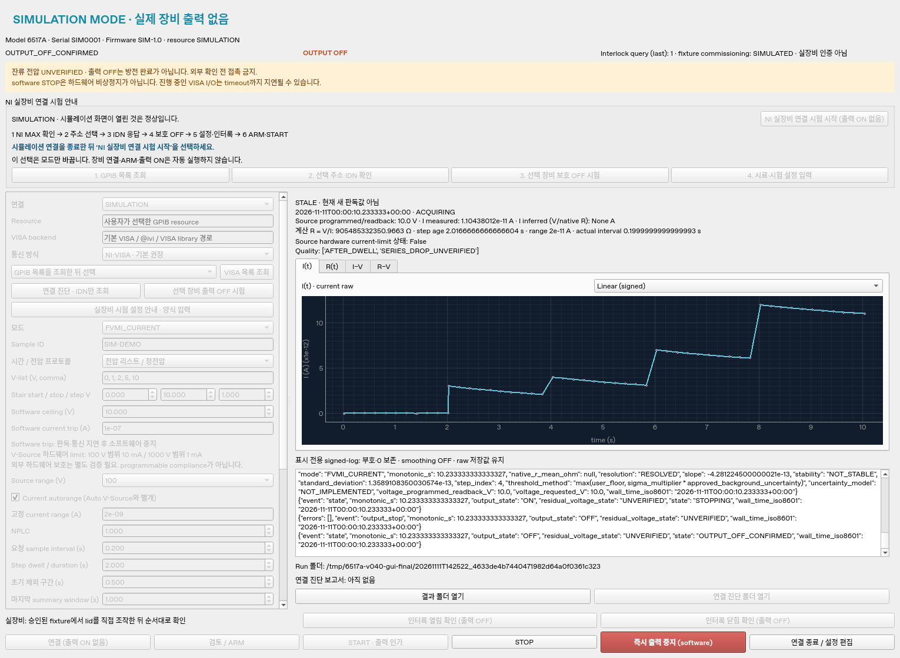
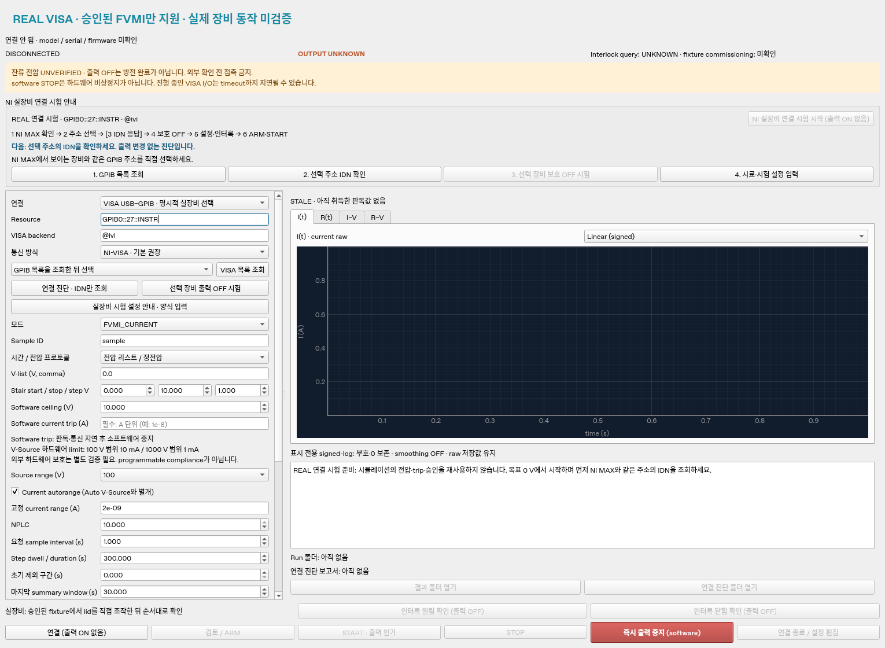
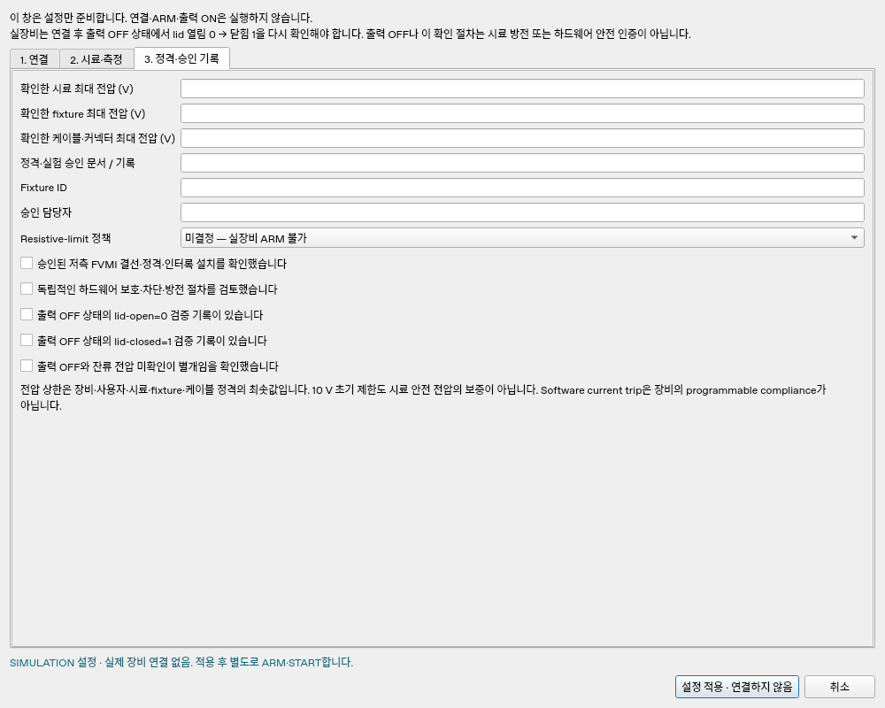

# Keithley 6517A · USB-GPIB 시험용 프로그램

Windows 10/11 64-bit 사용자가 시뮬레이션, USB-GPIB 연결 진단, 승인된 저전압 current 측정을 단계별로 시험하도록 준비한 v0.4.3 프로그램입니다. 정전압 시간 기록과 전압 리스트·staircase sweep를 실행하고, 계산 저항과 장비 저항 판독을 서로 다른 필드에 저장합니다. 상위 폴더의 이미지 중복 검색 앱과 독립적인 프로젝트입니다.

사용자가 첨부한 **6517A-900-01 Rev. D, May 2003** 원문을 확인해 명령·trigger·ASCII 응답 형식을 반영했습니다. 기본은 SIMULATION이며, 실장비 `FVMI_CURRENT`는 정격·실험 승인과 현재 연결에서의 출력 OFF/lid-open=0 → lid-closed=1 확인을 통과한 뒤 별도 ARM·START가 필요합니다. 매뉴얼 확인은 실제 6517A·어댑터 시험이나 1000 V 안전성 인증이 아닙니다. 실장비 native 저항 모드는 측정 전류를 이용한 보호가 검증되지 않아 계속 차단합니다.

원문 근거는 [명령표](docs/scpi_reference.md), 실제 수행한 소프트웨어 시험과 미수행 하드웨어 시험은 [검증 기록](docs/validation.md)에 구분했습니다. 출력 OFF와 시료 방전 확인은 별도이며 잔류 전압은 항상 `UNVERIFIED`입니다.

## Windows 시험 패키지로 시작

배포 파일은 [프로젝트 GitHub Releases](https://github.com/dropboxqfml-code/codex/releases)에서 게시된 버전의 `Windows-x64.zip`과 checksum을 선택합니다.

`6517A-USB-GPIB-Trial-0.4.3-Windows-x64.zip`을 로컬의 쓰기 가능한 폴더에 완전히 풉니다. 포함된 Python 3.12.14와 잠금 버전의 Windows 의존성을 사용하므로 Python·uv를 별도로 설치할 필요가 없습니다. `Start-GUI.cmd`는 기본 SIMULATION GUI를 열고, `Test-Simulation.cmd`는 실장비에 연결하지 않는 기능 시험을 실행합니다. 기본 NI-VISA 경로에는 **실제 모델·Windows 버전에 맞는 NI-488.2와 NI-VISA 64-bit**가 필요합니다. 이 소프트웨어가 이미 설치돼 있으면 호환되는 기존 설치를 사용합니다. 이번 버전은 선택 확장을 설치한 뒤 NI-VISA를 생략하는 `@py` 경로도 명시적으로 선택할 수 있지만, **NI-488.2 driver는 여전히 필요**하며 이 대안의 실제 장비 동작은 미검증입니다. HS/HS+ 등 정확한 모델과 driver 지원 조합은 사용자 PC에서 확인합니다.

먼저 [사용자 시험 순서](docs/user_hardware_trial.md)를 따라 시뮬레이션 → IDN-only 연결 진단 → 명시적 출력 OFF 점검 → 승인된 low-voltage current 시험으로 진행하세요. 이 단계에서 임의의 시료 정격이나 trip 값을 대신 승인하지 않습니다. 원격지에서 장비가 있다고 가정하거나 자동으로 출력 ON을 실행하지 않습니다.

ZIP의 Windows 파일 구성·잠금 wheel·무결성 검사와 실제 Windows 실행·6517A 측정은 서로 다른 검증입니다. 현재 수행한 범위와 패키지 결과는 [검증 기록](docs/validation.md)에 기록합니다. v0.3.0 GitHub Release의 Windows 소프트웨어 시험과 사용자 PC의 화면 실행 확인은 기록됐습니다. 이번 배포의 Windows 검증 여부는 해당 Release의 CI 결과와 `build-report.json`에서 확인하며, 실제 6517A 통신·측정 검증과는 구분합니다.

## 시뮬레이션 화면 다음 단계

`Verify-Bundle.cmd` → `Test-Simulation.cmd` → `Start-GUI.cmd` 후 **SIMULATION 화면이 열리는 것은 정상**입니다. 프로그램 시작으로 실장비에 전압을 인가하지 않도록 설계했습니다. 사용자는 v0.3.0 화면 실행과 NI MAX에서 6517A가 보이는 것을 확인했습니다. 이는 PC 화면·NI 도구에서의 관찰이며 이 프로그램의 IDN/측정 성공 기록은 아닙니다.

NI MAX에서 확인한 **같은 GPIB board·주소**를 프로그램에서 선택하세요. v0.4.3 연결 안내의 ‘NI 실장비 연결 시험 시작 (출력 ON 없음)’ 버튼은 장비를 자동 조회하거나 출력 ON을 하지 않습니다. SIM 연결 중이면 먼저 연결을 종료합니다. 실장비 준비로 전환할 때 가상 설정의 전압·trip·승인을 재사용하지 않고 목표 0 V·trip 미설정·미승인 상태로 초기화합니다. 이어 resource 선택 → IDN-only 진단 → 명시적 OFF 점검 → 승인된 설정·현재 연결 interlock 확인 → ARM → 별도 START로 진행합니다. 진단 보고서의 model·serial·firmware, 실제/가상 여부와 다음 확인 항목을 화면에서 구분합니다. NI MAX의 test panel과 다른 제어 프로그램은 먼저 닫습니다.

이미 NI MAX에서 인식되는 현재 PC에서는 기본 NI-VISA/`@ivi` 경로를 먼저 사용하세요. 선택 확장 설치 후 사용할 수 있는 `@py`는 **NI-488.2 only · experimental** 대안이며 오류 뒤 자동으로 다른 backend에 재연결하거나 명령을 재전송하지 않습니다. 자세한 선택 조건은 [VISA 안내](docs/windows_visa.md)에 있습니다.

## 소스 개발 환경

저장소의 `6517a` 폴더에서 실행합니다. 잠금 파일은 이 프로젝트의 `uv.lock`을 사용합니다.

```bash
cd 6517a
uv sync --locked
uv run --locked python -m keithley6517a
```

`6517A-USB-GPIB-Trial-0.4.3-Source.zip`은 검토·개발용 소스 배포본입니다. 소스에서 실행할 때는 Python 3.12 64-bit와 uv가 필요합니다. Windows의 driver/library 선택은 [VISA 안내](docs/windows_visa.md)를 참고하세요.

## 시뮬레이션 실행

GUI에서 SIMULATION 상태를 확인하고 설정을 검토합니다. 전류 trip과 잔류 전하 경고 확인 후 ARM으로 설정을 고정하고, 별도로 START를 누릅니다. ARM은 출력 ON이 아닙니다. 최초 목표값은 0 V이며 프로그램 시작·연결·설정 불러오기는 출력을 켜지 않습니다.

```bash
uv run --locked python -m keithley6517a.cli simulate --config examples/simulation_config.json --fast
```

`--fast`는 시뮬레이터용 fake clock으로 수 초·수 분의 실험 시간을 빠르게 진행합니다. 실제 시간 또는 장비 timing 성능 시험이 아닙니다. 일반 시간으로 보려면 `--fast`를 생략합니다. 예제의 전압과 trip은 가상 시료용 값이며 실제 시료 정격을 승인하지 않습니다.

추가 가상 실험 예제는 [`constant_bias_config.json`](examples/constant_bias_config.json)의 300 s 정전압/마지막 30 s 요약과 [`native_resistance_config.json`](examples/native_resistance_config.json)의 native 저항 판독입니다. 위 명령의 `--config` 경로를 바꿔 실행합니다.

`FVMI_CURRENT`는 `current_raw_A`와 계산 저항 `V/I`를 기록하며 `native_r_ohm`은 비웁니다. `NATIVE_RESISTANCE`는 장비 형식의 저항과 `current_inferred_A=V/R`를 기록하며 이를 측정 전류라고 표시하지 않습니다. 두 모드는 별도 run에서 비교하세요.

다음 조회·검증·복구 CLI 명령은 출력을 켜지 않습니다. `simulate`는 명시적으로 가상 장비의 ARM/START를 수행합니다. 실장비 실행 절차는 [commissioning 기록지](docs/commissioning_checklist.md)를 먼저 확인하세요.

```bash
uv run --locked python -m keithley6517a.cli validate examples/simulation_config.json
uv run --locked python -m keithley6517a.cli resources
uv run --locked python -m keithley6517a.cli identify "GPIB0::27::INSTR" --backend "@ivi"
uv run --locked python -m keithley6517a.cli recover runs
```

`GPIB0::27::INSTR`는 주소 형식 예시입니다. `identify`는 IDN 원문을 조회하며 장비 제어권을 인수하거나 OFF/방전을 보증하지 않습니다. 실제 제어권 인수 경로는 정확한 6517A 모델을 확인하고 보호 목적 OFF를 요청·확인합니다. 연결이나 설정 load는 출력 ON이나 실험 재개가 아닙니다. `recover`는 incomplete run만 `interrupted`로 표시하고 측정을 재개하지 않습니다.

## 연결 진단

NI MAX에서 board/address와 SCPI 통신을 먼저 확인한 뒤 test panel을 닫습니다. VISA resource 조회와 IDN-only 진단은 출력 ON·전압 설정을 수행하지 않습니다. 진단 결과는 고유 폴더의 JSON과 raw I/O로 저장하며, PC 정보·선택한 library·resource·장비 식별·실패 단계와 다음 확인 항목을 기록합니다. 진단 파일을 자동 업로드하지 않습니다.

```bash
uv run --locked python -m keithley6517a.cli diagnose --report-dir diagnostics
uv run --locked python -m keithley6517a.cli diagnose --resource "GPIB0::27::INSTR" --backend "@ivi" --report-dir diagnostics
# 아래 옵션은 식별 후 보호 목적 OFF/abort를 요청하는 별도 동작입니다.
uv run --locked python -m keithley6517a.cli diagnose --resource "GPIB0::27::INSTR" --backend "@ivi" --confirm-off --report-dir diagnostics
```

NI-VISA 없이 NI-488.2만 사용하는 대안을 명시적으로 시험할 때는 같은 명령의 `--backend "@ivi"`를 `--backend "@py"`로 바꿉니다. 이 경로는 기본 ZIP에 사전 설치되지 않은 선택 확장이 필요합니다. GUI를 닫고 `Enable-NI-Only.cmd`의 안내·라이선스를 확인한 다음 `INSTALL`을 입력해 잠금 버전의 PyVISA-py/gpib-ctypes를 사용자 PC의 `extensions/ni4882`에 설치하고 프로그램을 다시 시작합니다. 이 설치에는 인터넷 연결이 필요하며 NI GPIB driver/DLL은 설치하지 않습니다. 실제 장비와 Windows x64에서 이 backend를 검증하기 전에는 기본 경로의 검증 결과를 그대로 적용하지 않습니다.

주소는 예시입니다. 기본 IDN-only 결과의 output 상태는 `UNKNOWN`이며, 연결 성공을 OFF나 방전으로 표시하지 않습니다. `--confirm-off`도 실제 잔류 전압을 측정하지 않으므로 `UNVERIFIED`를 유지합니다. 진단·설정 대화상자는 ARM·START를 대신하지 않습니다.

## 실장비 current 측정 절차

먼저 [commissioning 기록지](docs/commissioning_checklist.md)의 독립 검증을 완료해야 합니다. [`low_voltage_template.json`](examples/low_voltage_template.json)은 의도적으로 미승인 0 V 상태이며 그대로는 START되지 않습니다. 실제 resource·software trip·시료/fixture/케이블 정격·승인 문서·`resistive_limit_enabled` 정책과 fixture ID·승인자·물리적 설치/전이 확인·독립 하드웨어 보호 검토 기록을 입력합니다. 정격과 승인값을 가상 예제에서 복사하지 마세요. v0.2.0 승인 파일도 `commissioning.hardware_protection_reviewed=true`를 실제 검토 후 명시해야 하며 자동으로 승인하지 않습니다.

GUI에서는 REAL VISA를 명시적으로 선택하고 연결합니다. OUTPUT OFF 확인 상태에서 lid를 실제로 열어 ‘인터록 열림 확인’, 닫아 ‘인터록 닫힘 확인’을 차례로 수행합니다. 같은 연결에서 `0` → `1`을 관찰한 뒤 ARM으로 설정과 저장 준비를 검증하고 별도 START로 실행합니다. 이 절차는 방전 확인이나 실제 하드웨어 차단 시험을 대신하지 않습니다.

CLI 실장비 경로는 다음과 같습니다. 위 승인 정보를 입력한 별도 설정 파일을 사용하세요.

```bash
uv run --locked python -m keithley6517a.cli measure --config approved_current_config.json
```

CLI는 출력 OFF 상태에서 `OPEN`, `CLOSED`를 각각 입력받아 실제 interlock 응답을 검사하고, ARM 후 인가 계획을 출력한 다음 마지막 `START` 입력을 요구합니다. 입력 문자열은 사용자 의도 확인이며 물리적 안전 인증이 아닙니다. `--fast`는 실장비 경로에 없습니다. `simulate`가 실장비 설정을 받거나 `measure`가 시뮬레이션 설정을 받으면 오류로 중단합니다. 이 CLI 경로의 실제 장비 실행은 아직 시험하지 않았습니다.

## 데이터와 검증

각 실행은 고유 폴더에 `config.json`, `metadata.json`, `readings.csv`, `summary.csv`, `events.jsonl`, `raw_io.jsonl`, `run_status.json`을 저장합니다. 원시 응답과 과도 구간도 보존하며, summary는 유효한 평균 구간만 사용합니다. `raw_io.jsonl`의 simulation 표시는 실제 수집 transcript와 구분하기 위한 것입니다. Portable 배포본에서는 `Test-Simulation.cmd`로 현재 버전의 가상 결과를 `results`에 생성합니다. 소스 저장소의 `examples/manual_verified_simulation`은 v0.2.0 원문 기반 예제, `examples/sample_simulation`은 v0.1.0 역사 자료이며 portable ZIP에는 포함하지 않습니다.







GUI의 시험 설정 대화상자에서 VISA·정격·fixture·trip·승인 정보를 입력할 수 있습니다. 고급 항목은 기존 전체 JSON 편집기와 설정 파일로도 관리합니다. 연결 중 설정을 고정하고, 설정 load 자체로 연결하거나 출력을 켜지 않습니다. 그래프는 각자 signed-linear 또는 symlog 표시를 선택하며 smoothing은 적용하지 않습니다.

```bash
uv run --locked pytest -q
uv run --locked ruff check .
uv run --locked ruff format --check .
# GUI가 없는 Linux
QT_QPA_PLATFORM=offscreen uv run --locked pytest -q
```

검증 범위와 실제 결과는 [검증 기록](docs/validation.md), [요구사항 추적](docs/acceptance.md)을 확인하세요. 시뮬레이터 시험 결과를 실장비 결과로 해석하면 안 됩니다.

## 실험 전에 읽을 문서

- [결선과 안전 정책](docs/wiring_and_safety.md): 승인된 저측 FVMI, 정격, 인터록, 방전.
- [측정·분석 규칙](docs/measurement_protocol.md): dwell, window, range 전환, 부호·noise floor.
- [단계별 commissioning](docs/commissioning_checklist.md): 장비 사용 재개 전 필요한 독립 확인.
- [사용자 하드웨어 시험 순서](docs/user_hardware_trial.md): 압축 해제부터 결과 확인과 시험 기록.
- [Windows / USB-GPIB / VISA](docs/windows_visa.md): 어댑터 드라이버와 SCPI 통신 설정.
- [구현 범위와 제한](docs/known_limitations.md): 차단된 기능과 선택 확장.
- [사용자가 제공한 요구사항 원문](docs/requirements_KO.txt).

프로그램의 ‘즉시 출력 중지’는 software stop입니다. 진행 중인 VISA I/O timeout, PC 정지, 통신 단절 또는 프로세스 강제 종료에 대응하는 하드웨어 emergency stop이 아닙니다. 독립적인 차단·인터록·방전 수단은 실제 하드웨어로 검증해야 합니다.
