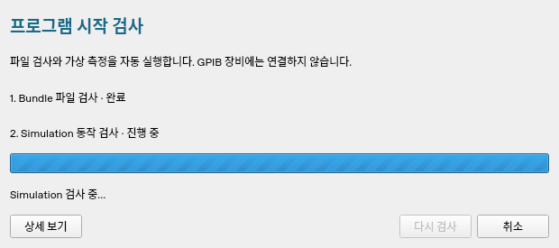
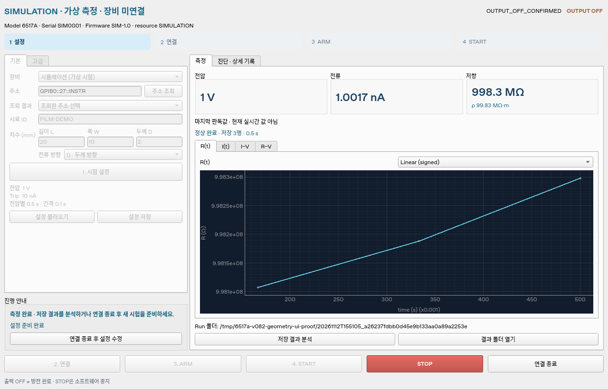
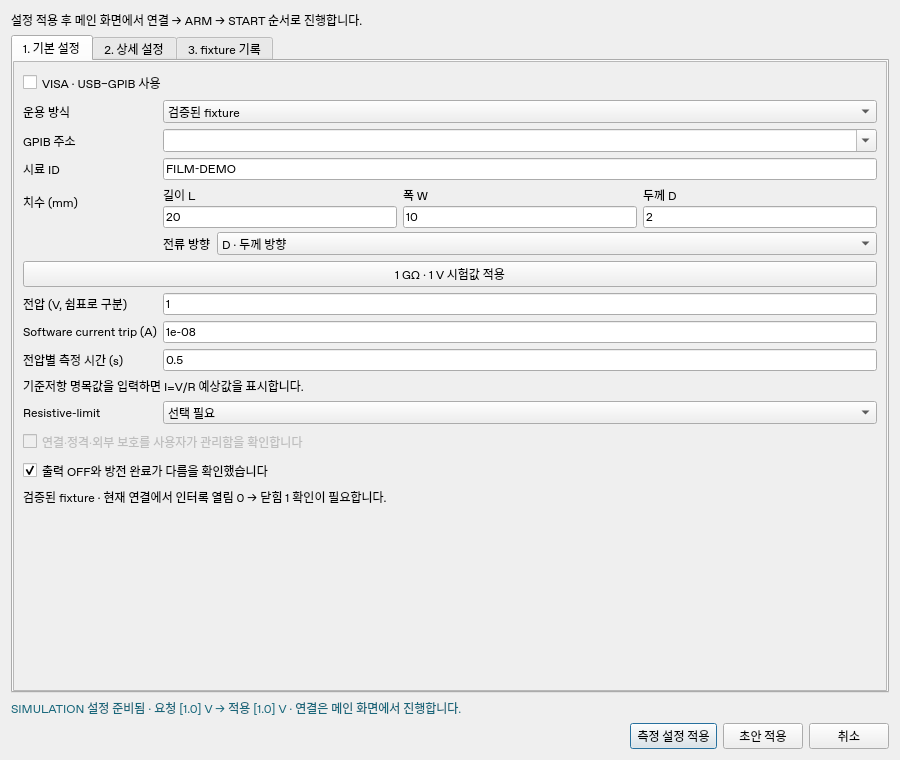
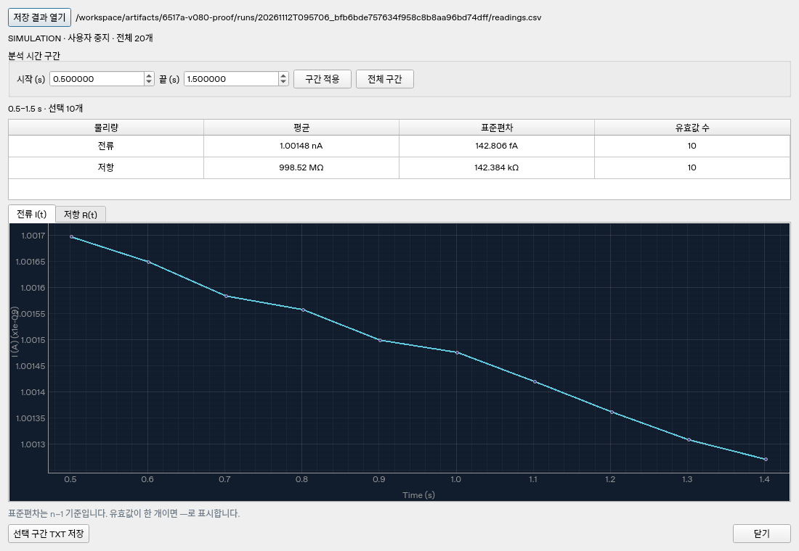

# Keithley 6517A · USB-GPIB 시험용 프로그램

Windows 10/11 64-bit용 v0.8.2 프로그램입니다. NI GPIB-USB와 6517A를 연결해 전압·시간·software current trip을 입력하고, ARM → START로 current 측정과 I(t)·R(t)·I–V·R–V 그래프 및 CSV·분석용 TXT 저장을 실행합니다. 정전압과 전압 목록을 지원하며 상위 폴더의 이미지 중복 검색 앱과 독립적으로 동작합니다.

연결 구성은 사용자가 관리하는 **저전압 시험 모드**와 기존 **검증 fixture 모드**를 선택합니다. 시작 화면은 SIMULATION·0 V이며, REAL 준비도 0 V·trip 미설정·사용자 확인 미선택에서 시작합니다. 설정 불러오기·초안 적용·연결만으로 출력 ON을 하지 않습니다.

## Windows에서 실행

[Windows ZIP 다운로드](https://github.com/dropboxqfml-code/codex/releases/download/6517a-v0.8.2/6517A-USB-GPIB-Trial-0.8.2-Windows-x64.zip)와 [SHA-256](https://github.com/dropboxqfml-code/codex/releases/download/6517a-v0.8.2/6517A-USB-GPIB-Trial-0.8.2-Windows-x64.zip.sha256)을 받습니다. 새 쓰기 가능한 폴더에 모두 풀고 **`Start-GUI.cmd` 하나만 실행**합니다. 시작 창이 **Bundle 파일 검사 → Simulation 동작 검사 → GUI**를 자동으로 진행하며, 두 검사를 통과하면 메인 화면을 엽니다. Python과 Python 의존성은 포함돼 있습니다. 호환되는 기존 NI-488.2·NI-VISA 64-bit 설치를 사용하며, 드라이버 설치 상태와 이 프로그램의 통신 결과는 구분합니다.

시작 창에서 현재 단계와 진행 기록을 확인합니다. 검사 실패 시 실패 단계와 기록을 확인하고 재시도할 수 있습니다. 자동 Simulation은 장비 연결 없이 수행하며 결과는 `diagnostics/startup-simulation`에 저장합니다. `Verify-Bundle.cmd`와 `Test-Simulation.cmd`는 개별 점검용으로 계속 사용할 수 있습니다.



## 메인 화면과 실행 순서

기본 화면에는 장비·주소, 시험 설정, 준비 상태, 판독값과 그래프를 표시합니다. 그래프 순서는 **R(t) → I(t) → I–V → R–V**이며 처음에는 저항 그래프를 엽니다. 상단 **1 설정 → 2 연결 → 3 ARM → 4 START**에서 현재 단계와 다음 작업을 확인합니다. 세부 설정은 왼쪽 **고급**, 연결 진단·장비 기록은 오른쪽 **진단·상세 기록** 탭에 있습니다.



가상 측정 화면이며 실제 장비 측정 결과가 아닙니다. 장비 선택의 **시뮬레이션 (가상 시험)**은 6517A 없이 측정 흐름·그래프·저장을 시험하는 모드입니다. **VISA · USB–GPIB**는 연결한 6517A를 사용하며, 선택한 뒤 연결·ARM·START를 각각 실행합니다.

1. 왼쪽 **1. 시험 설정**에서 전압·시간·trip을 입력합니다. 누락된 필수값은 설정 창에 표시되며 해당 항목을 누르면 입력란으로 이동합니다.
2. **측정 설정 적용**으로 필수 설정을 검증하고 **2. 연결**을 누릅니다. **초안 적용**은 미완료 입력을 보존하는 별도 버튼입니다.
3. **3. ARM**으로 장비 설정·readback·오류 큐·저장 준비를 검증합니다. 이때 출력은 OFF입니다.
4. ARM이 완료되면 **4. START**로 전압 인가와 수집을 시작합니다. 전압·전류·저항과 그래프를 확인하고 필요할 때 **STOP**을 누릅니다.

ARM이 비활성화되면 준비 상태에 누락 설정 또는 장비 조건을 표시합니다. START는 ARM 완료 전에는 대기합니다. 연결 후 미완료 설정을 발견하면 출력 OFF 상태에서 **연결 종료 후 설정 수정**을 누릅니다. 연결 종료 뒤 설정 창을 열며, 수정 후 다시 연결 → ARM → START로 진행합니다.

## 시료 치수와 비저항

시료 ID 아래에 **길이 L·폭 W·두께 D를 mm 단위**로 입력합니다. 시료의 긴 변과 전류가 흐르는 방향이 같다고 가정하지 않으므로 **전류 방향 L/W/D**도 선택합니다. 세 치수와 방향을 모두 입력하면 단면적 `A`와 전류 경로 길이 `ℓ`를 m 단위로 환산해 **`ρ = R × A / ℓ` (Ω·m)**를 계산합니다.



| 전류 방향 | 단면적 A | 전류 경로 길이 ℓ |
|---|---|---|
| L · 길이 | W × D | L |
| W · 폭 | L × D | W |
| D · 두께 | L × W | D |

예를 들어 L=20, W=10, D=2 mm를 D 방향으로 측정하면 `A=2×10⁻⁴ m²`, `ℓ=2×10⁻³ m`입니다. 저항이 1 GΩ라면 겉보기 체적 비저항은 **1×10⁸ Ω·m**입니다. 이 계산은 전극이 해당 단면 전체를 덮는 직육면체 모델입니다. 전극 접촉 면적이 더 작으면 실제 유효 전극 면적을 사용해야 합니다.

치수가 일부만 입력됐거나 전류 방향이 미지정이면 저항 측정과 치수 저장은 가능하며 비저항은 비워 둡니다. 치수·방향은 `config.json`과 `metadata.json`, 계산된 비저항은 `readings.csv`의 `resistivity_ohm_m`에 저장합니다. 기존 **`analysis.txt`는 시간·저항·전압·전류 네 열을 유지**합니다.

## 종료 상태와 저장 결과 분석

v0.8.2는 **정상 완료·사용자 중지·장비/통신 오류**를 구분합니다. STOP 뒤 출력 OFF와 저장이 확인되면 `stopped`로 기록하며, 오류나 OFF 미확인은 별도로 표시합니다. 저장된 판독 수와 결과 폴더를 확인할 수 있습니다.

**저장 결과 분석**에서 이전 결과 폴더의 `readings.csv`를 엽니다. 장비 연결 없이 I(t)·R(t)를 다시 보고 시작·끝 시간(s)을 지정해 구간을 선택합니다. 전류·저항 각각의 유효 개수, 평균, 표본 표준편차를 표시합니다. 값이 하나면 표준편차는 `—`입니다.



요약 구간 전에 STOP한 자료도 직접 분석할 수 있습니다. 선택 구간의 통계는 실행 중 자동 요약과 별개이며, 저항 평균은 개별 저항값의 산술평균입니다. 오류 판독은 통계에서 제외하지만 선택 TXT에는 선택한 원시 행을 보존합니다.

선택 구간을 네 열 TXT로 저장할 수 있으며 원본 CSV·자동 `analysis.txt`·기존 출력 파일을 덮어쓰지 않습니다. 원본 자동 TXT는 계속 모든 판독을 담습니다.

## 1 GΩ 저전압 시험 시작

실장비 준비는 **진단·상세 기록 → NI 실장비 연결 시험 시작**에서 NI MAX와 같은 주소로 IDN·보호 OFF를 확인합니다. NI MAX test panel은 닫습니다. 이미 확인한 진단을 반복할 필요 없이 기본 화면의 장비·주소와 현재 측정 설정을 확인할 수 있습니다.

**1. 시험 설정**에서 운용 방식 **사용자 관리 저전압**을 확인하고 **1 GΩ·1 V 시험값**을 누릅니다. 요청 1 V, source 범위 100 V, 상한 10 V 이하, software trip 10 nA, 명목 기준저항 1 GΩ가 입력됩니다. 다음 세 항목은 직접 선택합니다.

- 사용자 연결 관리 확인
- 잔류 전압 확인
- Resistive-limit ON/OFF 정책

Preset은 REAL/SIM·운용 방식이나 위 확인을 자동 승인하지 않습니다. 시간·저장 폴더를 검토한 뒤 **측정 설정 적용 → 연결 → ARM → START**로 실행합니다. 결과 폴더에 `readings.csv`, `analysis.txt`, `summary.csv`, `raw_io.jsonl`, `run_status.json`을 저장합니다.

1 GΩ의 명목 계산은 1 V에서 1 nA입니다. Preset의 10 nA는 검토·변경할 수 있는 software trip이며 장비의 programmable compliance가 아닙니다. 실제 판독은 기준저항의 교정값·허용차, settling·누설과 함께 비교합니다. [1 GΩ 시험](docs/reference_1gohm_trial.md)과 [사용자 시험 순서](docs/user_hardware_trial.md)에 상세 절차가 있습니다.

## 두 운용 방식

| 방식 | 실행 범위 | 연결·확인 처리 |
|---|---|---|
| `operator_low_voltage` · 사용자 관리 | **절대 10 V 이하**, source 100 V 범위 | 사용자 연결 관리 확인과 trip·resistive-limit 정책·잔류 전압 확인이 필요합니다. 정격 문서·fixture ID·과거 lid 전이 기록은 필수 입력이 아닙니다. |
| `verified_fixture` · 검증 fixture | 장비·설정·입력한 정격의 최솟값 이내 | 기존 정격·승인 기록 및 현재 연결의 OFF 상태 lid `0 → 1` 확인을 사용합니다. API 기본값과 기존 저장 설정은 이 방식입니다. |

두 방식 모두 실제 장비의 interlock 조회가 `1`이어야 하며, `0`·조회 실패·상태 오류에는 출력 ON을 차단합니다. 사용자 관리 모드가 물리적 인터록 설치를 인증한 것으로 기록되지는 않습니다. 실장비 `NATIVE_RESISTANCE`는 별도 측정 전류 보호가 없어 계속 차단하며, 실측은 `FVMI_CURRENT`로 진행합니다.

출력 OFF는 시료 방전 확인이 아닙니다. 잔류 전압은 `UNVERIFIED`로 남습니다. STOP은 단일 worker가 수행하는 software stop이며 VISA call·OS·통신 지연을 포함합니다.

## 시뮬레이션과 소스 실행

GUI의 SIMULATION 상태에서 같은 preset을 사용하면 `simulation_resistance_ohm=1e9`인 가상 모델을 사용합니다. 이 값은 실장비 transport나 실제 current 판독을 대체하지 않습니다. 기본 모델의 absorption·offset·noise가 포함되므로 명목 V/R와 차이가 있을 수 있습니다.

```bash
cd 6517a
uv sync --locked
uv run --locked python -m keithley6517a
uv run --locked python -m keithley6517a.cli simulate --config examples/simulation_1gohm_config.json --fast --progress
```

[`operator_current_template.json`](examples/operator_current_template.json)은 REAL·사용자 관리·0 V·미확인 초안입니다. GUI에서 완성한 실측 설정을 저장한 뒤 CLI에서 사용할 수도 있습니다.

```powershell
.\Run-CLI.cmd measure --config "configs\operator-current.json"
```

사용자 관리 모드의 CLI는 OPEN/CLOSED fixture 절차 대신 해당 운용 설정을 검사하고, ARM 후 실행 계획과 명시적 `START` 입력을 요구합니다. 검증 fixture 모드는 기존 OPEN → CLOSED → ARM → START 절차를 유지합니다. `--fast`는 시뮬레이션 전용입니다.

## 연결 진단과 선택 NI-only 확장

`Check-Connection.cmd`는 resource 목록 또는 선택 주소의 IDN-only 조회입니다. `Check-Output-Off.cmd`는 선택한 6517A에 보호 목적 OFF·abort를 요청하는 별도 동작입니다. 진단 결과와 원문 통신은 로컬에 저장합니다. 사용자 제공 기록에서 native NI-VISA 경로의 IDN과 보호 OFF 조회 `0`은 확인됐으며, 실제 전압 인가·current 수집 결과는 별도로 검증해야 합니다.

NI-VISA를 생략하는 `@py` 대안은 GUI를 닫고 `Enable-NI-Only.cmd`로 선택 확장을 설치한 뒤 명시적으로 선택합니다. 기본 ZIP에는 PyVISA-py·gpib-ctypes가 포함되지 않으며 NI-488.2 드라이버는 계속 필요합니다. [Windows VISA 안내](docs/windows_visa.md)를 참고하세요.

## 데이터와 검증

각 run은 기존 CSV·JSON 파일에 더해 **`analysis.txt`를 자동 저장**합니다. 탭으로 구분한 네 열이며 첫 행은 다음과 같습니다.

```text
Time (s)	Resistance (Ohm)	Voltage (V)	Current (A)
```

두 번째 행부터는 SI 단위의 숫자만 기록합니다. 시간은 측정 시작 후 경과 시간, 저항은 native 값이 있으면 그 값이고 그 외에는 원시 전류로 계산한 V/I, 전압은 source 설정 readback, 전류는 원시 판독입니다. 전압은 독립 측정한 시료 단자 전압이 아닙니다. 누락값은 `nan`으로 기록하며 역산 전류를 실제 판독처럼 채우지 않습니다.

요약 제외·과도 구간을 포함해 `readings.csv`의 모든 판독을 같은 순서로 저장하므로 STOP 전에 취득한 데이터도 남습니다. 품질 플래그와 측정 조건은 기존 `readings.csv`·JSON에서 확인합니다. 그래프는 signed-linear/symlog 표시와 부호·0을 유지하고 smoothing을 적용하지 않습니다.

이전 버전의 결과도 장비 연결 없이 변환할 수 있습니다. 기본 출력은 CSV와 같은 폴더의 `analysis.txt`이며 기존 파일은 덮어쓰지 않습니다.

```powershell
.\Run-CLI.cmd export-analysis "results\RUN\readings.csv"
# 다른 파일명으로 저장
.\Run-CLI.cmd export-analysis "results\RUN\readings.csv" --output "results\RUN\analysis-copy.txt"
```

```bash
uv run --locked pytest -q
uv run --locked ruff check .
uv run --locked ruff format --check .
# GUI가 없는 Linux
QT_QPA_PLATFORM=offscreen uv run --locked pytest -q
```

소프트웨어 검사, Windows 번들 실행과 실제 장비 시험의 범위는 [검증 기록](docs/validation.md)에 구분합니다. 공개 Release의 `Windows-software-tests.xml`과 `build-report.json`은 해당 CI 실행 결과입니다.

- [구현 범위와 제한](docs/known_limitations.md)
- [측정·분석 규칙](docs/measurement_protocol.md)
- [매뉴얼 명령표](docs/scpi_reference.md)
- [검증 fixture commissioning](docs/commissioning_checklist.md)
- [기존 결선 검토 문서](docs/wiring_and_safety.md)
