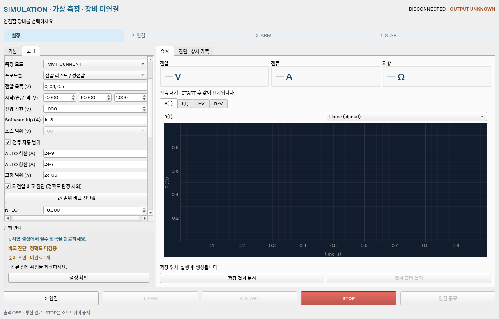

# AUTO 범위와 저전압 비교 진단 · v0.9.3

AUTO에서 약 158 pA에 머무는 사용자 관측을 범위별로 비교하기 위한 시험 기능입니다. **nA 범위 비교 진단값**은 낮은 pA 범위를 사용하지 않도록 AUTO 하한을 2 nA로 올립니다. 교정 상수를 복구하는 기능은 없으며 실제 장비의 158 pA 현상 해소는 아직 검증하지 않았습니다. 사용자 관측인 100 MΩ 저항의 고정 nA 범위 110~120 MΩ 표시도 정확도 합격을 뜻하지 않습니다.

v0.9.3은 사용자 비교 시험용이며 v1.0.0 정식 배포와 구분합니다. [Windows 시험판](https://github.com/dropboxqfml-code/codex/releases/tag/6517a-v0.9.3)의 실제 소프트웨어 실행 결과는 해당 Release의 JUnit·build report에서 확인합니다.

## AUTO 범위 설정

왼쪽 **고급**에서 **AUTO 하한 (A)**와 **AUTO 상한 (A)**을 입력합니다. 저장 설정의 필드명은 `current_autorange_min_A`·`current_autorange_max_A`입니다.

| 설정 | AUTO 하한 | AUTO 상한 |
|---|---|---|
| 기본값 | 20 pA · `2e-11 A` | 20 mA · `2e-2 A` |
| nA 범위 비교 진단값 | 2 nA · `2e-9 A` | 200 nA · `2e-7 A` |

한도는 6517A의 명목 전류 범위인 20 pA, 200 pA, 2 nA, 20 nA, 200 nA, 2 µA, 20 µA, 200 µA, 2 mA, 20 mA 중에서 지정하며 하한이 상한보다 클 수 없습니다. 범위 한도는 software current trip과 별개입니다.

FVMI AUTO의 ARM 구성은 다음 순서로 진행합니다.

1. 출력 OFF·AUTO OFF에서 기존 하한·상한을 조회합니다.
2. 새 구간을 설정할 수 있도록 상한을 20 mA로 넓힌 뒤 요청한 하한·상한을 쓰고 각각 readback·오류 큐를 검사합니다.
3. 선택한 하한 전류 범위에서 `Zero Check ON → Zero Correct ON → Zero Check OFF`를 수행하고 보정·완료·오류를 확인합니다.
4. AUTO를 ON으로 복원하고 실제 설정을 기록합니다.

고정 범위는 선택한 고정 범위에서 영점보정합니다. 보정·한도 readback 실패는 ARM을 중단합니다. 이 순서는 범위 설정과 영점보정 절차이며 전 범위 교정 정확도를 인증하지 않습니다.

## 비교 진단 실행

1. 장비 사용 시 **VISA · USB–GPIB**와 NI MAX에서 확인한 주소를 선택합니다. 연결 중이라면 출력 OFF에서 연결을 종료하고 설정을 수정합니다.
2. 왼쪽 **고급 → nA 범위 비교 진단값**을 누릅니다.
3. 준비된 값과 사용자 확인 항목을 검토한 뒤 **연결 → ARM → START**를 각각 실행합니다.



시뮬레이션·장비 미연결 상태의 설정 준비 화면입니다. 실제 측정 결과가 아니며, 미완료 확인 항목과 **비교 진단 · 정확도 미검증** 표시를 함께 보여 줍니다.

버튼은 다음 시험값을 준비하며 장비에 연결하거나 출력을 켜지 않습니다.

| 항목 | 준비값 |
|---|---|
| 운용·측정 | `operator_low_voltage` · `FVMI_CURRENT` |
| AUTO | ON · 2 nA~200 nA |
| 전압·시간 | 0 V → 0.1 V → 0.5 V · 각 30 s |
| 적분 | NPLC 10 |
| Software current trip | 기존 값이 10 nA 이하이면 유지, 미설정이거나 더 크면 10 nA |
| 비교 진단 | **저전압 비교 진단 (정확도 판정 제외)** 선택 |

연결 관리·잔류 전압 확인·resistive-limit ON/OFF 정책은 사용자가 확인합니다. 잘못된 기존 trip 입력은 오류로 표시하므로 수정해야 합니다. 비교 진단을 직접 구성할 때도 FVMI·사용자 관리 저전압·source 100 V 범위와 **요청 전압의 절댓값 1 V 이하** 조건을 충족해야 합니다.

정상 측정은 `:STAT:QUES:COND?`의 B8, 즉 `condition & 256`이 참이면 교정 이상으로 ARM을 차단합니다. 명시적으로 선택한 저전압 비교 진단은 이 조건을 기록하면서 비교 관측을 허용합니다. 화면의 **비교 진단 · 정확도 미검증** 표시를 유지하며, 정상 정확도 판정을 수행하지 않습니다.

오류 큐의 `+513 Calibration data lost`, overflow·sentinel, software current trip, 인터록·출력 상태·통신 오류와 잘못된 판독의 중단 처리는 계속 적용합니다. 프로그램은 `:CALibration` 쓰기를 하지 않으며 교정 상수를 재생성하거나 정상 상태로 바꾸지 않습니다.

## 판독과 통계의 구분

비교 진단 판독에는 `CALIBRATION_DIAGNOSTIC_ONLY`를, 교정 이상이 관찰된 판독에는 추가로 `CALIBRATION_INVALID`를 기록합니다. 다른 판독 오류가 없는 경우 원시 전류와 계산 저항 수치를 보존합니다. 진단 모드의 모든 판독은 `valid_for_summary=False`이므로 다음과 같이 처리합니다.

- 자동 요약의 유효 개수는 0이며 정확도용 평균·표준편차를 제시하지 않습니다.
- 저장 결과 분석에서도 진단 판독을 통계에서 제외합니다. 원시 그래프·수치는 비교 관측 자료로 보존합니다.
- 설정·교정 condition·품질 플래그·진단 목적은 CSV·metadata·상태 기록과 화면에서 확인합니다.
- `analysis.txt`는 첫 행의 물리량·단위와 이후 숫자만 사용하는 기존 네 열/다섯 열 형식을 유지합니다. 경고·설명을 TXT에 끼워 넣지 않습니다.

범위에 따른 전류의 변화, 0 V와 각 전압 단계의 응답, 실제 사용 range를 함께 비교합니다. 명목 저항에 맞춘 전류 치환이나 관측 오차를 상쇄하는 임의 보정은 적용하지 않습니다.

## 출력 OFF 상태의 설정 스냅샷

GUI를 닫거나 장비 연결을 종료한 상태에서 기존 명령을 사용합니다.

```powershell
.\Check-Output-Off.cmd GPIB0::27::INSTR @ivi
```

이 명령은 기존 보호 OFF·abort와 장비 식별을 수행합니다. 출력 OFF를 확인한 뒤 다음 조회를 추가하고 `diagnostic.json`의 `autorange_snapshot`과 `raw_io.jsonl`에 보존합니다. 추가된 스냅샷 조회는 AUTO·range·교정 설정을 쓰지 않습니다.

| 조회 | 저장 내용 |
|---|---|
| `:STAT:QUES:COND?` | condition 원문·정수값, B8 교정 이상 여부 |
| `:SENS:CURR:RANG:AUTO?` | 실제 AUTO ON/OFF |
| `:SENS:CURR:RANG?` | 현재 전류 range(A) |
| `:SENS:CURR:RANG:AUTO:LLIM?` | 실제 AUTO 하한(A) |
| `:SENS:CURR:RANG:AUTO:ULIM?` | 실제 AUTO 상한(A) |

`complete`와 진단 성공은 위 조회와 OFF 확인의 성공을 의미합니다. `calibration_invalid=True`인 스냅샷도 조회가 성공하면 완료로 저장할 수 있으며, 교정·측정 준비 합격을 뜻하지 않습니다. 일부 조회가 실패하면 해당 명령·응답·오류와 `partial` 또는 `failed` 상태를 기록합니다.

교정 condition 조회는 교정 이상 비트를 지우지 않습니다. 원문 근거와 판독 응답 해석은 [SCPI 명령표](scpi_reference.md), 소프트웨어 검증 범위는 [검증 기록](validation.md)을 참고합니다.
