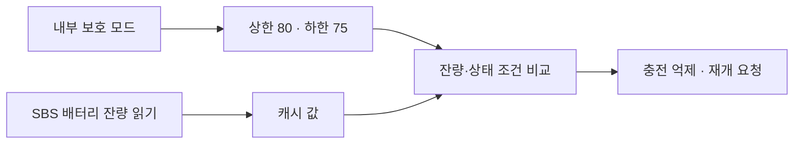

# EC 내부의 80/75 충전 보호 코드 후보 — 2026-11-07 한국 시간

**조건부 정적 해석에서 배터리 잔량 80% 이상일 때 충전을 억제하도록 요청하고, 75% 이하에서 추가 조건을 확인해 재개하도록 요청하는 코드 사슬을 연결했습니다.** 보호 모드의 임계값 설정, 실제 배터리 polling 자료, 같은 값의 상·하한 비교, 충전기 옵션·전류·전압 쓰기 요청까지 이어집니다.

아래 명령어·bank 모델을 전제로 한 분석이며, **현재 노트북의 동작이나 Windows에서 사용할 수 있는 제어 계약은 아직 검증하지 않았습니다.** 앱의 실제 충전 제어는 미구현·Unsupported입니다.

## 해석 모델과 독립 대조

보유 P05ACJ CAP 및 EC 영역의 고정 길이·SHA-256을 확인한 뒤 데이터를 정적으로 디코딩했습니다. Intel 8051 호환 명령어와 하위 48KiB 공통 영역·상위 16KiB bank 전환 모델을 가정했습니다. 실제 원본의 전환 stub과 업데이트 주소 관계가 이 모델을 지지합니다.

모델은 시작 코드 형태뿐 아니라 독립적으로 분석한 두 역할과도 맞습니다. 하나는 원본 버전 문자열을 반환하는 경로이고, 다른 하나는 Setup/HII에서 확인한 USB 깨우기 설정을 처리하는 경로입니다. USB 메시지 첫 바이트와 별도 공유 객체의 필드를 구분해 대조했습니다. 이 교차 확인은 해석의 근거를 강화하지만 제조사 문서에 의한 칩·ISA·메모리 정의나 실제 장치 관측을 대신하지는 않습니다.

우리 분석용 디코더는 바이트를 명령어 형태로 표시할 뿐입니다. 원본 펌웨어 명령어를 실행하거나 에뮬레이션하지 않았습니다.

## 연결한 충전 보호 흐름

| 단계 | 조건부 해석에서 대조한 내용 |
| --- | --- |
| 보호 모드 설정 | 내부 메시지의 모드가 특정 활성 값으로 바뀌면 상한 80·하한 75를 저장합니다. 임의의 입력값에 대한 지원은 판정하지 않았습니다. |
| 배터리 값 생산 | 14개 polling 항목 중 수치 경로의 한 항목이 SBS 명령 `0x0D`를 읽습니다. 성공한 word 응답을 저장하고, 상·하한 비교가 같은 캐시 값을 읽습니다. |
| 상한 조건 | 해당 보호 모드가 활성화되고 잔량 값이 상한 이상이면 충전 요청 상태를 억제 쪽으로 바꿉니다. |
| 하한 조건 | 잔량 값이 하한 이하이고 유효값·추가 배터리 상태 조건을 통과하면 정상 요청 상태로 바꿉니다. |
| 충전기 요청 | 억제 경로는 옵션의 한 비트를 바꾸고 전류·전압에 0을 보내도록 요청합니다. 정상 경로는 옵션과 준비된 전류·전압 값을 다시 보내도록 요청합니다. |

별도의 비율 계산 경로는 DesignCapacity/FullChargeCapacity 자료를 사용합니다. 이 비율을 현재 잔량이나 80/75 상한 비교값으로 혼동하지 않았습니다. USB 충전·깨우기, 배터리 trip-point 알림, 보정, 밝기·CPU 알림도 충전 상한과 분리했습니다.

레지스터 의미는 공개된 고정 버전 소스 두 개와 별도로 대조했습니다. [SBS 배터리 정의](https://raw.githubusercontent.com/torvalds/linux/v6.6/drivers/power/supply/sbs-battery.c)는 `0x0D`를 0..100 잔량 값으로, [TI 계열 충전기 정의](https://raw.githubusercontent.com/torvalds/linux/v6.6/drivers/power/supply/bq24735-charger.c)는 관측한 레지스터 묶음을 옵션·충전 전류·전압으로 설명합니다. 옵션 bit 0의 충전 억제 의미와 제조사 ID 비교값도 구조에 맞습니다. **이 비교는 실제 부품을 BQ24735로 식별하거나 Linux 호환성을 Windows 지원으로 전용하는 근거가 아닙니다.** 해당 코드를 실행·포팅하지 않았습니다.

## Windows 연결과 실제 적용은 아직 미확정

이번 내부 메시지는 기존 WMI/SABI 명령과 다른 계층입니다. 그 번호를 기존 WMI 프레임에 넣어 시험하지 않습니다. x64 펌웨어의 일반 EC 중계 callback도 추가로 연결했습니다. 이 경로는 callback의 20바이트 snapshot 중 선택한 10바이트를 내부 30바이트 EC 메시지에 복사하며, 프로젝트의 WMI payload는 별도의 16바이트입니다. 소프트웨어 gate·전체 길이 대응·실제 실행 시 선택은 미확정입니다. 첫 송신 상태를 검사하지 않고 후속 대기 결과로 덮는 경로도 있어 일반 완료·ACK만으로 새 응답을 보장하지 못합니다. 복사 결과를 보호 상태의 신선한 재조회로 사용하지 않습니다.

특히 충전기 쓰기 요청을 보내는 선택 경로는 각 쓰기의 반환 상태를 확인하지 않은 채 다음 요청과 소프트웨어 상태 갱신으로 진행합니다. **내부의 마지막 동작 표시는 실제 적용 성공·전기적 충전 중단·재개를 입증하지 않습니다.** 내부 모드 설정 요청의 echo도 독립적인 설정 재조회로 사용할 수 없습니다. 모드 유지·재부팅 후 복원·현재 활성 상태는 확인하지 못했습니다.

과거 단발 WMI 결과의 첫 `FF`도 이 발견만으로 다시 해석하지 않습니다. 기존 실험의 재실행·예약 초기화나 새로운 장치 호출은 하지 않았습니다.

## 검증과 남은 작업

보호 모드·임계값 경로는 원본 바이트 단언 27개와 선택한 조건부 명령 312행, 버스·충전기 경로는 19개·522행, polling 자료 생산은 별도 검토 50개·464행으로 보존했습니다. 통합 검산에서는 66개 선택 구문, 모드의 상·하한 비교, 동일 캐시의 생산·소비, 충전기 word 바이트 순서 및 공개 레지스터 정의를 대조했습니다. 숫자는 선택 범위이며 전체 EC 펌웨어 분석률이나 앱 테스트 수가 아닙니다.

[정적 검사 기록](reports/ec-charge-protection-audit.json)에 근거와 조건을 저장했습니다. 원본 펌웨어·전체 디스어셈블리·포트·물리 주소·실행용 메시지 구성은 저장소·배포물에 넣지 않습니다.

남은 핵심은 해석 모델을 보강하고 **현재 Windows 경로의 정확한 전달 계약과 안전한 상태 재조회**를 확보하는 것입니다. 소스 안의 보호 로직 후보를 현재 장치 지원·실제 적용 상태로 승격하지 않습니다. 앱·테스트 코드·기존 ZIP은 변경하지 않았고 새 EXE도 만들지 않았습니다. 이번에는 정적 검증만 수행해 빌드·단위 테스트를 반복하지 않았습니다. C# 437개 / Python 85개 통과와 전체 빌드 경고·오류 0개는 코드 커밋 `5d77df5`의 이전 기록입니다. 추가 노트북 시험·자료 제출·드라이버/서비스/보안·펌웨어 변경은 필요하지 않습니다.
