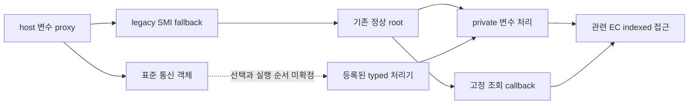

# 관련 EC 접근의 보호 순서 조사 — 2026-11-08

**구현 후속:** 별도 사용자 승인 뒤 [고정 A 도구](FIXED_READ_A_IMPLEMENTATION.md)를 추가했습니다. 명시적 정상 플랫폼 전제를 실제 runtime관측으로 승격하지 않으며 새로운P05제공자/typed edge발견은0입니다. 일반 entry차단과Unsupported·설정쓰기/재시도/B금지, 후속실기결과미수신을 유지합니다. 아래는 이전 조사·판정 기록입니다.

**후속 판정 정정:** [현재 구현 검토안](READ_TRIAL_A_IMPLEMENTATION_PROPOSAL.md)은 정상 등록·inline 관련 처리·같은 초기화 완료/비재진입 P05 stream을 명시적 적용 전제로 사용합니다. 새 공식 대표 Core source에서 참조 IPL의 Context→실제 entry→typed 처리→NULL-root→반환을 연결했으며 실제 P05 provider/typed edge 발견은0입니다. provider 본문과 별도 공통 owner를 같은 stream 근거에 중복 요구하지 않습니다. 아래 미연결은 source 발견 상태의 기록이며 조건부 제안 자체를 막는 절대조건으로 바꾸지 않습니다. 새 firmware 호출 구현에는 별도 명시 승인이 필요합니다. 사용자 Complete·UEFI 결과는 이미 [수신 기록](WINDOWS_BOOT_UEFI_RESULT.md)에 있으나 위 전제나 실제 보호 순서 관측은 아닙니다.

**이전 관측 기능 추가 시점:** [Windows 부팅 방식 보고](WINDOWS_BOOT_FIRMWARE_UPDATE.md)를 추가했습니다. 이는 기존에 없던 표준 메타데이터로 특정 OS EFI 변수 경로의 적용 범위를 좁히는 방법이며, 아래 source 미연결을 복구한 것은 아닙니다. 당시 노트북 결과는 아직 없었고 실제 조회·제어는 보류했습니다.

**이번 조사로도 핵심 보호 순서의 새 연결을 확보하지 못했습니다. 실기 전 첫 단계는 아직 미완료입니다.** [적용 검토](FIXED_READ_APPLICABILITY_REVIEW.md)에서 한정한 private Runtime hook의 EC 접근을 고정 조회와 같은 보호 순서에 연결하는 근거를 조사했습니다. 부팅 초기화·실제 SMI 진입·통신 입력을 구분하고, 기존 상태값이 공통 자원 owner를 제공하는지도 대조했습니다. 실제 보호값 조회나 충전 제어의 성공을 보고하는 문서가 아닙니다.

## 유지하는 긍정 근거와 정확한 미연결

정상 proxy 설치·private wrapper/backend 선택, 초기화 완료·비재진입의 정상 실행 영역이라는 기존 조건을 유지합니다. 알려진 NULL cache legacy fallback은 같은 정상 root 안에서 관련 변수를 처리하는 source 연결이 있습니다. 조회 callback과 연결된 다른 SW/GPI 참여자의 정상 stream 순서도 유지합니다.

그림은 위 정상 초기화 조건의 선택 source 관계입니다. 현재 노트북에서 각 분기를 관측한 경로도, 두 통신 대안을 한 호출에서 모두 실행하는 흐름도 아닙니다. 점선은 실제 공급 객체의 통신을 등록된 처리기와 해당 보호 순서에 적용하는 경계입니다. 등록 존재·GUID 일치·정상 API 성공만으로 그 순서를 새로 입증하지 않습니다.

실제 제공자 기계코드 복구만을 유일한 해법으로 요구하지 않습니다. 해당 플랫폼의 적용 가능한 실행 영역/경로 계약이나 같은 자원 owner의 source 근거로도 이 경계를 설명할 수 있습니다. 다만 이번에 그 근거가 새로 생기지는 않았습니다.

## reference와 실제 진입의 세 단계

이미 확보한 공식 UDK2014 PiSmmIpl의 선택 문맥을 저장 P05 근거와 대조했습니다. 새 자료 취득이나 P05 전체 검색은 하지 않았습니다.

| 단계 | 확인한 범위 | 사용할 수 없는 치환 |
| --- | --- | --- |
| PE bootstrap 호출 | reference는 loaded PE의 EntryPoint에 shared private Context를 전달함. P05의 dispatcher 초기화 인수 공급도 별도로 기록돼 있음 | bootstrap을 호출했다는 사실을 실제 SMI entry 등록·메시지 처리로 바꾸지 않음 |
| 실제 SMI entry 등록 | reference는 다른 registration receiver에 private entry field를 넘김. P05의 기존 normal callback/thunk 체인은 별도 source 근거 | reference의 entry field가 P05의 bootstrap target이나 deferred field와 같다고 추론하지 않음 |
| runtime 통신 입력 | reference는 message/size를 공유 field에 넣고 Trigger에 진입. P05의 기존 special record 첫 field는 deferred function이며 입력은 legacy 규약 | reference message pointer를 P05 deferred function 또는 NULL-root walk에 대응시켜 새 typed 호출을 만들지 않음 |

reference의 등록 호출 뒤에는 상태 assertion과 registered flag 저장이 있습니다. 선택 코드에는 별도의 오류 분기·early return이 없으므로 flag만을 등록 성공의 독립 증명으로 쓰지 않습니다. 실제 등록 실패나 P05 버그를 관측한 결과는 아닙니다. 정상 공급·등록 성공이라는 기존 조건을 유지합니다.

이 비교로 새로운 P05 supplier·SMI entry·typed dispatch 경로를 선택하지 못했습니다. 이미 확인한 legacy 경로를 표준 통신으로 다시 이름 붙이지도 않습니다.

## 다른 상태값이 공통 owner를 대신하는가

| 기존 source 상태 | 구분한 역할 | 이번 판정 |
| --- | --- | --- |
| variable-family busy 상태 | 해당 변수 처리 계열의 진입·반환 규약 | SABI 조회가 같은 소유권을 획득한다는 연결 없음 |
| flash context의 nesting과 method-local busy | 선택 flash 작업의 중첩·호출 구간 상태 | 다른 상태와 구분. 이것만으로 조회의 입력 준비~마지막 indexed 접근을 보호한다고 볼 수 없음 |
| selected EC hook의 상태 flag | 전후 hook의 선택·게시 상태 | 공통 자원 acquire/release token으로 확인되지 않음 |

flash nesting은 begin/end 사이에 이어질 수 있지만 method-local busy는 각 호출이 반환하기 전에 해제됩니다. hook flag는 sender 전에 바뀌어 전후 상태로 남으며 indexed 접근마다 획득·반납하는 lease가 아닙니다. 따라서 이 서로 다른 상태를 합쳐 전체 교환의 잠금으로 부를 수 없습니다.

normal proxy의 PIC mask 저장/복원과 일반 RAM staging을 별도 EC actor로 추가하지 않습니다. private helper의 context pointer 동기화도 새로운 SABI owner로 바꾸지 않습니다. 작업 내부 상태·중첩·flag의 존재와, 서로 다른 참여자의 공유 자원 소유권은 별개입니다.

이미 같은 정상 실행 stream에 속하는 분기에서는 그 순서 근거가 적용됩니다. variable-family busy를 공유하지 않는다는 사실을 해당 분기의 별도 추가 blocker로 남기지 않습니다.

이 검토는 선택한 source 구간의 역할·범위에 한정됩니다. 모든 계산된 callback·별칭·외부 제공자의 부재나 현재 loaded state를 증명한 것은 아닙니다. 그 미확인을 실제 경쟁자나 관측된 race로 보고하지도 않습니다.

## 다음 조사의 재개 조건

새로 필요한 것은 **표준 통신을 통해 실행되는 관련 private Runtime hook이 조회와 동일 보호 순서에 속한다는 구체 근거**입니다. 예를 들면 실제 공급 객체/호출자가 정상 진입·typed 선택으로 이어지는 source, 그 실행 순서를 보장하는 적용 가능한 플랫폼 계약, 또는 두 관련 경로가 공유하는 자원 owner의 구체 연결입니다. 이 예들을 모두 동시에 확보해야 한다는 뜻은 아닙니다.

이번 entry 비교와 상태값 분류는 동결합니다. 같은 GUID/operand 검색·legacy 본문·copy/reader 검산을 다시 실행해 진전으로 세지 않습니다. 새 source나 실제 연결 단서가 없는 상태에서 다음 정적 검산만 추가하면 시험에 가까워진다고 말할 수 없습니다.

모든 writer/IRQ의 부재, live EC 전체 hash, gate-open 관측, 새 SDK 구현 원문, 같은 노트북 진단·DLL·TXT 재제출을 추가 필수조건으로 두지 않습니다. 초기 direct-host 예외를 정상 proxy와 동시에 넣지 않으며 기존 worker 입력 분리·ISR 보존·SDK 수명 계약도 유지합니다. mode 후보1과 현재 임계값·실제 충전 적용의 구분은 그대로입니다.

## 검증과 실행 경계

선택 reference 문맥과 기존 source/proof pin의 대조, 한정된 hook owner 범위 검산, 독립 읽기 검토를 수행했습니다. [정제 기록](reports/indexed-ordering-contract-audit.json)에 범위·핀·미확정 사항을 남깁니다. 기계적 검산 성공은 위 미연결의 해결이나 실제 호출 허가가 아닙니다. 새 실제 supplier/typed 경로·공통 owner·실기 race 관측은 0입니다.

C#/SDK/test·프로젝트·배포 EXE/ZIP은 변경하지 않아 이번 빌드·C# 회귀는 재실행하지 않았습니다. 628개와 전체 net48 Release 경고·오류0은 `ae8f8e7`의 이전 검증 기록입니다. 공개 `PrepareSdkAsync`는 `ReadSpecificationUnavailable`이며 보호 조회·충전 제어는 `Unsupported`입니다.

A의 최대1method·고정 byte 샘플0~1·handshake/초기화/재시도/쓰기/B fallback0을 유지합니다. 사용 완료된 과거 예약 접근·초기화·삭제·재사용·우회, 실제 SDK/OEM/하드웨어/Global 객체 호출, 원본 실행·로드·에뮬레이션, 실행 요청·주소 조합·frame·nonce/generator, 드라이버/서비스/보안/펌웨어·클라우드 환경 변경은 없습니다. 새 노트북 실행이나 파일 제출은 필요하지 않습니다.
