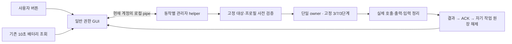

# 일반 GUI 수동 충전 보호 제어 베타

**후속 배포:** 화면 순서·버전·결과 수신 시각·오류 안내를 개선한 [베타2](MANUAL_CONTROL_BETA2.md)가 있습니다. 아래 ZIP과 안내는 첫 베타의 바이트로 보존합니다.

**실기 후속:** [사용자 실행 결과](MANUAL_CONTROL_BETA_RESULT.md)에서 GUI 보호 해제가 사전1 → 사후0, SDK3·설정1·읽기2, 정리 `Complete`로 완료됐습니다. 아래의 새 GUI 미검증 표시는 배포 당시 기록이며 이번에는 해제 경로의 실제 실행이 추가로 확인됐습니다. ZIP과 동봉 안내는 배포 당시 바이트로 보존합니다. 충전 자료 재제출은 필요 없습니다.

2026-11-10 한국 시간. 기준 `cf068c0`의 [실기 결과와 다음 개발 계획](PROTECTION_CONTROL_FUNCTIONAL_RESULT_AND_GUI_PLAN.md)을 보고 사용자가 **“다음 개발 시작해.”**라고 지시한 범위로 구현했습니다. 이전 노트북 시험에서 확인한 80% 충전 억제와 1→0 해제 후 85%까지의 충전 재개를 기반으로, 일반 GUI의 수동 동작과 3/7/3회 호출 제한을 연결했습니다. 클라우드에서는 실제 Windows·노트북·OEM 호출이나 시험 예약 접근을 하지 않았습니다.

[새 프로그램 ZIP](../downloads/ATIVBatteryGuard-MANUAL-CONTROL-BETA.zip) · [사용 순서 전문](MANUAL_CONTROL_BETA_USER_STEPS.txt) · [새 검증 기록](reports/manual-control-beta-validation.json)

## 사용하는 방법

1. 새 ZIP 하나를 새 로컬 폴더에 모두 풀고 **ATIVBatteryGuard.exe를 일반 권한으로 실행**합니다. 기존 시험 ZIP과 파일을 합치지 않습니다.
2. 시뮬레이션이 꺼진 상태에서 **보호 상태 확인**을 누르고, 같은 계정의 관리자 확인과 동작 안내에 응답합니다. 정상 조회와 대상 확인 뒤에 켜기·해제 버튼이 활성화됩니다.
3. 원하는 **80% 보호 켜기** 또는 **보호 해제 · 일반 충전**을 선택합니다. 매번 새 사전값을 읽고 설정은 최대 한 번만 수행합니다. 이미 목표 모드이면 쓰지 않습니다.
4. 화면의 관련 정리 `Complete`와 마지막 모드·임계값 후보를 확인합니다. **제어 결과 TXT 저장 → 결과 저장 폴더 열기**로 새 `manual-control-*.txt`를 보관할 수 있습니다.

저장 폴더는 기존 `%LOCALAPPDATA%\ATIVBatteryGuard`입니다. 각 카드에 저장 완료와 파일명을 표시합니다. 같은 제어 결과나 같은 세션의 동일 샘플은 중복 저장하지 않습니다. 새 샘플·새 요청 결과가 생기면 다시 저장할 수 있습니다. 저장 실패 시에는 제어를 반복하지 않고 저장만 다시 시도할 수 있습니다.

이번 GUI 확인에서는 먼저 상태 조회, 관리자 확인, 버튼·결과·저장 표시를 확인하면 됩니다. 직접 켜기·해제를 선택했다면 새 제어 결과 TXT로 전환과 실제 정리를 확인합니다. 충전 경과까지 비교했다면 그때의 새 관찰 TXT를 추가할 수 있습니다. 과거 진단·삼성 DLL·EXE·옛 결과를 다시 제출하거나 같은 단발 시험을 반복할 필요는 없습니다.

**이미 80%보다 높은 잔량은 즉시 80%로 내려가지 않습니다.** 보호를 켜면 이후 충전을 억제하는 동작을 관찰합니다. 해제는 임계값을 100으로 설정하거나 이전 임계값으로 복원하는 기능이 아닙니다. 완충과 재부팅 뒤 원복도 보장하지 않습니다. 전류·충전기 레지스터와 실제 전기적 효과는 별도로 확인해야 합니다.

## 연결한 실행 경로

일반 GUI는 `asInvoker`이며 앱 실행만으로 자동 권한 상승이나 OEM 요청을 하지 않습니다. 버튼을 직접 누른 뒤에만 고정 helper를 `runas`로 시작합니다. 기존 배터리 갱신은 `GetSystemPowerStatus`만 사용합니다. 속성 getter는 마지막 조회 스냅샷만 읽고 WMI/OEM을 호출하지 않습니다.

사용자 희망 설정, 마지막 조회 후보, Windows 배터리 잔량을 구분해 표시합니다. 앱 시작, 절전 진입·복귀, 시뮬레이션 전환 뒤에는 과거 결과를 현재값으로 복원하지 않습니다. 끝난 요청의 늦은 진행 표시와 상태 초기화에 겹친 조회 결과도 새 상태를 덮어쓰지 못합니다.

| 명시적 동작 | SDK 진입 상한 | 설정·결과 |
| --- | ---: | --- |
| 보호 상태 확인 | 3 | 모드·상한·하한 읽기만 수행. 쓰기 0회 |
| 80% 보호 켜기 | 7 | 새 사전 모드가 0일 때만 의미상 입력1을 최대 1회 요청하고, 사후 1/80/75를 비교. 이미 1이면 첫 읽기 뒤 쓰기 없이 종료하며 임계값은 미조회 |
| 보호 해제 | 3 | 새 사전 모드가 1일 때만 의미상 입력0을 최대 1회 요청하고 사후 0을 비교. 이미 0이면 첫 읽기 뒤 쓰기 없이 종료 |

전후 읽기는 위 상한에 포함하며 작업 뒤 자동으로 추가 조회하지 않습니다. 모드1만으로 임계값 80/75를 추론하지 않습니다. 불일치·불명 결과에서 자동 OFF→ON 보정, 재시도 또는 역방향 복원을 하지 않습니다. 대상은 기존 Windows 10 x64·940X3G/930X3G·P05ACJ profile, 정확한 metadata와 단일 Active 인스턴스로 제한합니다. 기존 0→1/1→0 단발 attempt·실행 코드·예산·예약은 재사용하지 않습니다.

새 `ManualProtection-v1` sealed attempt는 동작별 단계 순서, 고정 요청, 입력0/1과 동일한 대상을 검사합니다. 비교 내용은 동작에 따라 24바이트 또는 56바이트를 한 번 생성하며, 전부 0이거나 중복된 비교 묶음이 있으면 중단합니다. SDK 진입 직전에 같은 attempt·request·index·target·observer와 호출 상한을 다시 검사합니다. 중립적인 응답 검사, callback·owned input·transport, 공통 mutex와 불명 자원을 보유하는 차단 상태(quarantine)는 재사용합니다. 기존 SDK 입력 준비에는 새 typed entry 24줄만 추가했습니다.

## 권한·통신·정리 경계

비공개 pipe는 현재 사용자 SID로 ACL을 제한하고 Network SID는 거부합니다. SID는 내부 권한 설정에만 사용하며 사용자 이름·그룹·SID·작업 nonce를 결과나 로그에 남기지 않습니다. helper의 client 권한 위임 수준은 `Identification`입니다. job·nonce는 로컬 요청을 구분하기 위한 값이며 장치 상태 인증이나 펌웨어 성공 증거가 아닙니다. 동작 enum, 길이, 필드 수, 상태·카운터 조합을 검사하는 4096바이트 이하의 프로토콜만 받으며 임의 frame·주소·임계값·경로는 받지 않습니다.

helper는 현재 토큰 `Elevated`, Windows 10 x64와 동작 자기확인을 검사한 뒤 새 `ManualProtectionV1/active.operation`을 `CreateNew/WriteThrough/Flush(true)`로 선점합니다. 기존 `Experiments`의 과거 marker는 조회·삭제·수정하지 않습니다. 새 원장도 실제 정리와 현재 요청에 대한 유효한 ACK 뒤에만 자기 기록을 정상 해제합니다. 프로세스 비정상 종료, 통신 유실, 불명 상태 또는 ACK 누락이면 기록을 보존해 새 작업을 차단합니다. 경로 보안 검사 오류는 `Unavailable`, 실제 `CreateNew` 경쟁만 `Busy`로 분류합니다.

단일 owner를 사용하며 실제 호출(invocation) → 출력(output) → 입력(input)의 종료를 확인하고 대상 객체(target)까지 정리합니다. 화면 표시의 10초 deadline과 owner 획득의 2초 제한은 펌웨어를 강제로 중단하는 시간이 아닙니다. helper는 관련 실제 종료를 기다린 뒤 `Result`를 보냅니다. GUI가 현재 요청의 결과를 검사해 ACK를 보내면, helper는 자기 원장을 해제한 뒤 `Released`를 보냅니다. GUI는 `Released`까지 받아야 완료를 수용합니다. 프로세스 종료, 카운터0 또는 pipe 종료만으로 실제 정리를 추정하지 않습니다.

pipe 유실은 다음 단계의 입장을 중단할 의사만 전달합니다. 이미 시작한 SDK 호출을 강제 취소하거나 조기 정리하지 않습니다. Pending과 공통 quarantine을 다른 동작·목적으로 우회하지 않습니다. 기존 읽기 전용 파일 검사 worker의 timeout 뒤 `TryStop/Kill` 패턴도 제어 helper에는 사용하지 않습니다. 진행 중 중복 클릭·시뮬레이션 변경·창 닫기를 막고, 실제 종료가 불명확하면 추가 설정을 차단합니다.

**Pending·불명 상태에서는 강제 종료, 반대 방향 설정, `active.operation` 수정·삭제로 복구하지 않습니다.** 새 제어 결과 TXT를 보관하고 현재 상태를 전달합니다. UAC나 동작 확인에서 시작을 취소하면 펌웨어 호출 없이 종료합니다. 실제 정리는 끝났지만 조회 자료가 불명확하면 현재값을 표시하거나 쓰기를 활성화하지 않고, **보호 상태 확인**을 직접 눌러 다시 확인합니다.

## 검증과 제한

새 108그룹(모델 12 · 프로토콜 12 · core 20 · SDK 17 · lease 9 · helper 9 · VM 18 · client 11)을 포함해 **1081개 통과·실패0·건너뜀0**입니다. Portable과 전체 net48 참조 Release 빌드는 각각 경고·오류 0개입니다. 새 EXE 두 개와 Core/Interop의 실제 assembly 경계 및 WPF/XAML을 컴파일했습니다. Release에서는 portable 전용 입장, 가짜 종료, 임의 테스트 폴더로의 lease 진입을 제외했습니다. GUI의 SDK 참조와 `InvokeMethod` 부재도 검산했습니다. **새 GUI/helper 조합의 실제 노트북 실행은 아직 미검증입니다.**

ZIP은 GUI·helper·Core/Interop·두 config와 안내·BUILDINFO·SHA의 총 9개 항목입니다. 삼성 원본 DLL/EXE·firmware·PDB·다른 실험 EXE는 포함하지 않았습니다. 기존 ZIP 68개, 허용한 9개 수정 파일을 제외한 기존 소스 204개, 기존 등록부 외 테스트 89개는 같은 바이트로 보존했습니다. App 단독 빌드에서도 고정 helper 파일을 같은 출력 폴더에 준비하도록 설정했습니다. [정제 검증 기록](reports/manual-control-beta-validation.json)에 소스 195개, 빌드 바이트, 내부 SHA 8개·CRC, Release IL과 독립 감사를 보관합니다.

미서명 개발 베타입니다. 드라이버·서비스·보안 정책 변경, BIOS flash, 자동 시작·부팅 자동 적용, 외부 네트워크 통신·자동 업로드는 없습니다. 이전 실기 성공을 다른 모델 지원, 재부팅·절전 뒤 지속성, 75% 하한 재개 또는 100% 완충 보장으로 확대하지 않습니다. 이번 배포의 목표는 확인된 모델의 명시적 수동 제어와 실패 처리를 GUI에 연결하는 것입니다.
