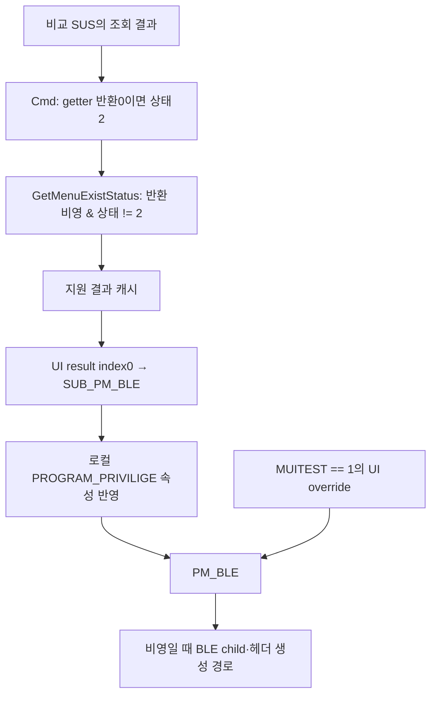

# OEM 배터리 메뉴·상태·전송 연결 분석 — 2026-11-06 한국 시간

**현재 계열 원본 후속:** [940X3G Settings2.2.0.18 확보·프로그램설명반영](CURRENT_MODEL_OEM_EVIDENCE_UPDATE.md)을완료했습니다. 아래는2.0.0.89 비교원본의분석이며새원본의다른모듈구성에그대로대입하지않습니다. 현재장치지원·충전제어는계속미확정입니다.

**저장된 분석을 재개해 비교용 Settings2.0.0.89의 배터리 조회 결과에서 메뉴 생성까지 연결했습니다.** 조회 결과·메뉴 지원 캐시·UI 속성·화면 표시가 서로 다른 단계입니다. `FF`, 메뉴 부재, 초기화 반환1을 현재 노트북의 기능 부재나 충전 설정 확인으로 사용할 수 없습니다. 실제 충전 제어는 Unsupported를 유지합니다.

## 출처와 검증 범위

[직전 재개 메모](SETTINGS_CALLER_ANALYSIS_HANDOFF.md)의 ZIP을 다시 해시해126,414,820바이트/SHA-256 `a501fde3b9870e3840d1b4561255c70e3cece4e9426c1070ff8481446d8ba3b7`와 일치함을 확인했습니다. 제조사 EXE/DLL/MSI·함수·AML은 실행하거나 로드하지 않았습니다. 캐시에 있는 데이터를 trusted pefile/capstone과 구조 파서로만 읽었습니다. 사용자 파일을 다시 받거나 노트북·예약 표식에 접근하지 않았습니다.

| 실제 분석 파일 | SHA-256 | 역할 |
| --- | --- | --- |
| SUS.dll1.0.5.7 x86 | `650f8fc4480ee64e377553886f7c67530afd9773e1f85d4154f46da903235a89` | 비교 배터리 getter/setter |
| EasySettingsCmd.dll | `648b0facab46ee8837c70b0a337546b826cf01a7087b1949dbe8758ff76a4f73` | 상태 enum·지원 메뉴 캐시·명령 |
| EasyControlCenter2.dll | `83c17bd9c0238d135fbebbbdb030b8c290deda923b169e109f24216a7c032185` | 컴파일된 UI 속성·메뉴/child 생성·표시 |
| EasySettingsCmdServer.exe | `1cc54b63aeb03c3b47b605d1aa3cd9015ad2a481e0965a9e0130de4de0318932` | 명령 중계·Wrapper 초기화 |

이 원본은 NP930X5J의 Win7 배포 목록에서 받은 외부 패키지의 실제 Win8 구성입니다. 파일 버전2.0.0.89와 MSI ProductVersion2.0.1을 구분합니다. Win7·Win8에 같은 SUS/Cmd 바이트가 들어 있는 것은 같은 구현의 두 배치이며 독립 실기 시험 두 건이 아닙니다. 현재940X3G/930X3G·P05ACJ·Windows10 적용성과 제조사 서명 신뢰는 별도로 미확정입니다.

## SUS 조회 계약의 독립 감사

주 SUS의 FE20 → CC10을 실제 바이트로 독립 검토해 다음 분기를 확인했습니다. 아래는 소스 코드의 정적 관측이며 실행 절차나 새 OEM 요청 명세가 아닙니다.

| 확인한 조건 | 호출자 outStatus | 범위 |
| --- | ---: | --- |
| 선행0B 뒤 첫 바이트 bit3 설정 또는 API 반환의 AL 비영 | 2 | 이 분기에서는65로 진행하지 않음. 전체 HRESULT 검사로 표현하지 않음 |
| 선행 조건 통과 뒤65의 첫FF | 2 | 65 API 결과는 검사하지 않음 |
| 같은 조건에서65 첫01 | 1 | 비교 호출자의 enum |
| 같은 조건에서65의 나머지 첫 바이트 | 0 | API 실패 뒤 남은 입력 값도 배제한 판정이 아님 |

16바이트 초기화와 같은 버퍼 사용을 확인했습니다. 0B 호출CC4C와65 호출CC68 사이의 쓰기는CC64의 첫 바이트80뿐입니다. **호출자가 나머지15바이트를 다시 쓰지 않는다는 사실**이 확인됐습니다. 0B가 tail 전체를 썼거나 tail이 비영 값이라는 뜻은 아닙니다.

기존 단발 도구의 `WsabiWmiOneShotPolicy.CreatePayload()`는 첫80과 나머지zero인16바이트를 생성하며 선행 응답을 입력으로 받지 않습니다. 코드상 호출 순서가 다르고 전체 payload 값의 동등성은 미확정입니다. 이 차이를 새 인코더·새 호출 순서·반복 시험으로 구현하지 않습니다. 과거 기록의 첫FF만으로 동일 입력·같은 OEM 분기·현재 보호 상태를 복원할 수 없습니다.

SUS 정상 getter API 반환1과 outStatus0/1/2도 별도 값입니다. Cmd 설명 문자열은2를 `not support`라고 이름 붙이지만, 위처럼 여러 조건을 합친 호출자/UI 분류입니다. 현재 모델의 물리적 배터리 기능 부재 판정으로 전용하지 않습니다.

SOSI/SUS1.0.6.1 x86/x64도 별도로 대조했습니다. 11바이트 버퍼·0B API 결과 검사 부재·같은 버퍼 재사용을 확인했고, native11과 WMI data16을 혼합하지 않았습니다. x64 setter 명령 본문은10F20입니다.

## 메뉴 생성까지 연결한 흐름

이 그림은 비교 프로그램의 컴파일된 분기입니다. 실제 장치 실행·새 조회·UI 설정 변경을 수행한 결과가 아닙니다.

| 파일 / 근거 RVA | 연결 |
| --- | --- |
| Cmd83250 및2C780 | SUS getter 반환 비영이고 상태2가 아닐 때 지원1, 그외0. 지원 결과를 캐시/재사용 |
| ControlCenter2C0D0, 2C231–2C240 | SupportBLEMenu::GetMenuExistStatus의 result0을 SUB_PM_BLE 속성에 저장. 명령 핸들이 없으면0 fallback |
| ControlCenter29656–29745 | PROGRAM_PRIVILIGE==0이면 PM_BLE0, 다른 관측 분기는 SUB_PM_BLE 값 복사 |
| ControlCenter2979F–297C2 | MUITEST==1이면 PM_BLE1을 넣는 UI override |
| ControlCenter8332B–83351 → 828D0 | PM_BLE 비영일 때 child 생성 함수를 호출 |
| ControlCenter82D45–82E17 | BLE child(dialog8027)와 별도 헤더/button을 생성하는 경로 |

관측한 역할은 **뷰·헤더 생성 추가**입니다. 기존 control의 EnableWindow 전환으로 표현하지 않습니다. PROGRAM_PRIVILIGE의 값 생성자는 닫지 못했으므로 관리자 권한 조건으로 이름 붙이지 않으며 관리자 재시험을 요청하지 않습니다. MUITEST는 코드상의 UI override일 뿐입니다. 값을 바꾸거나 지원 우회에 사용하지 않습니다. BOM의 `Test=Yes`와 같은 입력으로 취급하지 않습니다.

따라서 메뉴가 없을 수 있는 소프트웨어 경로에는 OEM 상태 분류, 지원 캐시, 명령 핸들 fallback과 로컬 UI 속성이 함께 들어 있습니다. 이는 비교 원본에서의 관계이며 현재 Settings2.2 메뉴 부재의 단일 원인을 확정한 결과는 아닙니다.

## 상태 enum과 화면 표시도 구분

ControlCenter254C0은 CmdBatteryLifeExtend::GetStatus를 찾아 명령을 보내고 result index0을 읽으며, 명령 핸들이 없으면2를 반환합니다. 호출25400에서 BLEStatus 속성으로 옮겨 View65610 갱신 경로로 이어집니다.

확인한 ViewUpdate는 BLEStatus==1일 때만 그리기 상태1을 사용하고, 별도 nonzero-flag 경로의 generic state setter19300은 비영 여부를 사용합니다. 후자의 lifecycle·ShowWindow 호출은 확정하지 않았습니다. 이 때문에2를 전체 UI에서 언제나 OFF로 그린다고 단정하지 않습니다. 메뉴 생성 조건과 상태 표시 경로, 지원 캐시가 다르며 실제 화면/장치 read-back은 관측하지 않았습니다.

OnEnable/OnDisable의 UI wrapper25500은 명령 핸들이 없어도 선택값을 로컬 BLEStatus에 기록합니다. Cmd setter의 반환1에 따른 캐시 변경과도 구분해야 합니다. 화면이 바뀌었다는 관측만으로 요청 전달·펌웨어 적용·read-back 성공을 확인할 수 없습니다.

외부 `sSettings.xml`과 `sSettings64.xml`은 Task Scheduler 정의이며 배터리 UI XML이 아닙니다. 확인한 PE 리소스 범위에서도 UI XML을 확보한 것으로 보고하지 않습니다. 이번 메뉴 연결은 컴파일된 함수·속성·생성 분기를 근거로 합니다. 도움말/INI의80% 라벨만으로 상태 의미나 실제 적용을 확정하지 않습니다.

## 설정 반환·초기화·전송의 한계

- SUS setter FDE0 → CB80은66/81·80의 결과를 검사하지 않습니다. 이후6000/6310 helper를 거쳐 확인한 정상 복귀에서1을 반환합니다. 이1은 read-back 비교에 조건부인 성공이 아닙니다. 후속 helper 전체 callgraph는 닫지 못했으므로 부수효과가 없다거나 모든 중첩 경로에서 하드웨어 읽기가 없다고 확대하지 않습니다.
- Cmd OnEnable5F930/OnDisable7AB80은 SUS 반환1에 따라 소프트웨어 캐시를1/0으로 바꿉니다. 이것을 장치 적용 성공으로 사용하지 않습니다.
- Cmd SetCountFile5FD60에는 호스트 EXE 폴더의 conf.ini 값이-1일 때 조건부 setter를 부르는 경로가 있습니다. 실제 패키지 conf.ini는 nValue103입니다. 원본의 조건부 경로·다른 부수효과는 그대로 존재하며 실제 호스트 경로·설정 이력은 미관측입니다. 실행 진단으로 사용하지 않습니다.
- Server는 Wrapper Init을 호출하고, Wrapper는 loader 성공 뒤 실제 모듈 Init을 부른 후 자체1을 반환합니다. 모듈 Init의 반환 계약은 확정되지 않아 ‘모듈 실패를 숨긴다’고 명명하지 않습니다. Wrapper의1이 모듈·WMI·장치 초기화 성공 검증이라는 근거도 없습니다.
- Wrapper의 모듈 선택, Cmd의 generic SABI loader, 배터리 함수가 정적 import한 SUS의 loader는 서로 다른 층입니다. 동일한 것으로 합치지 않습니다. 보고 OS6.2/6.3의 WSABI 분기와 현재 Windows10의 실제 보고 값·DLL 검색 결과를 구분합니다.

## 현재 모델과 충전 제한 가능성

940X3G 문자열의 일반 모델 분류는 확인했지만, BLE 지원 allowlist와 연결된 것으로 입증하지 못했습니다. P05ACJ의 보존 분석은0B가 모듈 flag를 복사하고 미변경 초기 첫 flag7F에는 bit3이 설정됐음을 보여 줍니다. 초기 값이 그대로인 조건에서는 비교 SUS의 상태2 분기와 연결되지만, 실제 런타임 flag 변경·현재0B 응답은 미관측입니다. 초기7F를 실기값으로 사용하지 않습니다.

현재 모델의65/66 처리자·안전한 지원 범위·신뢰할 수 있는 설정 read-back 연결은 여전히 미확정입니다. 배터리 상태 표시와 과거 WMI 응답의 구조 검증은 이미 동작했지만 실제 충전 상한 구현의 증거와는 별개입니다. **이번 결과로 충전 제한 가능/불가능을 확정하지 않으며 제어를 활성화하지 않습니다.**

이번 요청은 저장된 분석의 재개이므로 앱·개발 도구 소스·테스트·EXE·기존 ZIP은 유지하고 분석 문서만 갱신합니다. 빌드·테스트는 반복하지 않았습니다. C#435/Python85는 이전 검증 기록입니다. 원본·디스어셈블리·추출 데이터는 비공개 캐시에만 보존합니다.

다음 근거는 현재 모델에 적용되는 OEM 버전 또는 P05ACJ 처리 계약을 위 호출자 계약과 연결할 수 있는 정적 출처여야 합니다. 같은 첫FF·같은 기록·단순 모델 문자열을 재해석해 이 간극을 채우지 않습니다. 추가 업로드·노트북/관리자 반복·OEM 호출·예약 접근·드라이버/서비스/보안/펌웨어 변경은 필요하지 않습니다.
