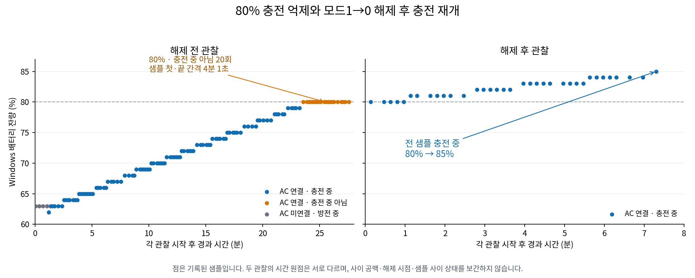

# 충전 제한·해제 실기 결과와 수동 제어 GUI 개발 계획

**2026-11-10 후속:** 사용자의 다음 개발 지시에 따라 [일반 GUI 수동 제어 베타](MANUAL_CONTROL_BETA.md)를 구현·검증·공유했습니다. 아래의 구체적인 3/7/3회 호출 계획과 명시적 수동 동작 범위를 적용했습니다. 새 GUI/helper 조합의 실제 노트북 실행은 다음 확인 항목입니다. 아래는 실기 분석과 구현 전 계획의 기록입니다.

2026-11-09 한국 시간. 기준 `e0666d6`. 사용자가 제출한 해제 전 관찰·해제 도구 결과·해제 후 관찰의 세 TXT를 데이터로만 분석했습니다.

## 판정

**이번 노트북의 전후 시험에서는 의도한80% 충전 억제와 보호 해제 후 충전 재개를 기능적으로 확인했습니다.** 저장 모드1→0의 독립 후보 비교가 정상이고, AC 연결 중80%에서 멈춘 기록 뒤에 해제 후85%까지 충전하는 기록이 이어집니다. 이는 단일80% 표시나NotCharging 한 번만으로 내린 판정이 아닙니다. 보호 설정에 접근하고 동작을 바꾸는 경로가 있다는 강한 실기 근거를 확보했습니다.

| 단계 | 파일에서 확인한 결과 | 판정 |
| --- | --- | --- |
| 해제 전 관찰 | 123개 샘플. 처음4개는 AC 미연결·방전. 이후119개는 AC 연결이며62→80% 상승. 마지막20개는80%·NotCharging | 분석된 상한 억제 정책과 일치하는 동작 |
| 보호 해제 | Elevated·Claimed·Ready, 사전모드1→사후모드0, read후보2, ReceiptOnly, SDK3회·설정1회, 관련정리Complete | 의도한 저장 모드 전환과 호출·정리 조건을 충족 |
| 해제 후 관찰 | 35개 모두 AC 연결·Charging,80→85% 상승.30개는80%를 넘음 | 상한 해제 뒤 충전 재개·상승을 관찰 |
| 자료 품질 | 두 관찰 모두Observed, 읽기 오류0·30초초과간격0, 샘플간격10~20초 | 선언한샘플수·경과초·CSV내용이 일치 |

해제 전80%·NotCharging 샘플의 첫 시각은 관찰 시작 후1413초, 마지막은1654초이며 첫·끝 간격은 **241초(4분1초)**입니다. 샘플 사이를 보간하거나241초를 연속 전류 측정 시간으로 세지 않습니다. AC 첫 연결 시점은72초·62%이며, 파일의 처음63%와는 구분합니다.

해제 후 기록은 새 관찰 시작 후8초에80%·Charging이고,68초에처음81%,438초에85%입니다. 첫·끝 샘플 간격은 **430초(7분10초)**입니다. 이8초는 해제 요청 이후 지연시간이 아니라 새 관찰 세션의 경과초입니다. 두 관찰의 시간 원점을 직접 연결하거나 파일 사이 공백·정확한해제시각을 추정하지 않습니다.

## 해제 도구의 결과 검토

`Protection1To0-v1`은 정상사전검증·owner획득·3역할입장·SDK3/set1·후보2·모드1→0일치를 보고했습니다. 표시시점과실제종료뒤의두진단블록이각각 PreMode=`CorrelatedStoredByteCandidate`, SemanticSet0=`ReceiptOnly`, PostMode=`CorrelatedStoredByteCandidate` 순서와 일치합니다. 관련정리는Complete이며 오류·timeout·Pending은 보고되지 않았습니다. `고정3단계 요청 준비: None`은 준비 오류가 없다는 값입니다.

설정응답ReceiptOnly자체를 독립적인 실행성공ACK로 바꾸지 않습니다. 이번 판단은 정상사후조회와 전후충전기록을 함께 사용합니다. TXT에는 원시프레임·비교내용이 없으므로 원시응답 귀속·텍스트진위·물리적장치동일성·충전기연결의파일사이연속성을 암호학적으로 인증한 분석은 아닙니다.

이번 결과에서 확인한 것은 **이노트북·이번조건의기능동작**입니다. 전류·충전기레지스터독립측정,75%하한에서의자동재개,재부팅·절전뒤설정지속,100%완충,다른모델/BIOS지원은아직검증하지않았습니다. 이들을현재기능성공의부정근거나같은시험을다시요구하는이유로사용하지않습니다.

현재TXT의“일반앱보호조회/제어Unsupported”와관찰보고의“실제충전제한확인:미확인”은프로그램이자동으로지원·성공을승격하지않도록둔고정표시입니다. 이번세자료를대조한기능검증과구분합니다. **해당모델의단발제어는실기로확인됐고,일반GUI의수동제어연결은아직구현하지않은상태**입니다. 앱이현재도모드0인지실시간조회한것으로표시하지않습니다.

## 다음 버전의 목표

다음개발은 **기존GUI의수동보호제어베타**입니다. 사용자는일반권한앱에서“80%보호켜기”또는“보호해제·일반충전”을선택하고,그동작에필요한관리자확인만수행합니다. 별도실험EXE를찾아실행하고TXT를여러개조합하는과정을줄입니다. 대상은이번에검증한Windows10x64·940X3G/930X3G·P05ACJ profile로제한합니다.

### 1. 비동기 작업과 상태 표시를 연결

새비동기수동제어서비스와불변조회결과스냅샷을만듭니다. 사용자희망값,마지막으로읽은모드·임계값후보,Windows잔량을분리합니다. 앱시작이나절전복귀뒤에지난결과를현재값으로복원하지않고,조회시점과Unknown을표시합니다.

현재 `MainViewModel.ActualModeText`는동기 `physical.GetCurrentMode()`를읽으므로,이getter에WMI를넣지않습니다. 속성은캐시만읽고실제호출은명시적사용자동작에서만수행합니다. 기존10초배터리갱신은GetSystemPowerStatus만유지합니다. 작업중에는재클릭을막고관리자요청·사전확인·설정·사후확인·실제정리·완료/불명을같은화면에표시합니다.

### 2. 일반 GUI와 전용 관리자 helper의 제어 경계를 확정

GUI는일반권한을유지하고명시적클릭뒤에만고정helper를같은계정으로상승실행합니다. helper는아래고정동작만받고임의명령·주소·frame·임계값·실행경로를외부입력으로받지않습니다. 로컬IPC의요청·결과schema/길이·동작대응·동일작업귀속·계정경계를설계하고,진행중작업과종료불명을다른요청으로덮지않습니다.

| 제안 동작 | 동작당 SDK 진입 상한 | 쓰기·중단 조건 |
| --- | ---: | --- |
| 보호 상태 확인 | 3 | 모드·상한·하한의고정읽기만. 쓰기0 |
| 80% 보호 켜기 | 7 | 새사전모드0일때만semantic1최대1회.전후읽기는이예산안에포함 |
| 보호 해제·일반 충전 | 3 | 새사전모드1일때만semantic0최대1회.전후모드읽기는이예산안에포함 |

이미요청한모드이면쓰지않습니다. 모드1하나만으로현재임계값80/75를추정하지않고,임계값불일치·불명에서자동OFF→ON보정하지않습니다. 모드0을100%적용완료로표시하지않습니다. 작업뒤자동추가조회·retry·자동반대방향쓰기·원복을추가하지않습니다.

기존읽기전용 `WindowsSamsungFileInspectionProvider`의worker종료패턴을제어helper로복사하지않습니다. 이worker는timeout뒤TryStop을호출합니다. 제어경로는실제invocation→output→inputjoin과전체target정리를끝내야하며,timeout·취소·통신유실·프로세스종료만으로완료를만들거나helper를강제kill하지않습니다. Unknown/Pending에서추가쓰기를차단하고공통owner/mutex/quarantine을유지합니다.

위동작당예산과반복수동사용은 **다음버전의제안범위이며이번결과분석으로새로승인된호출이아닙니다.** 기존단발코드·고정목적·소모예약을수정·삭제·재사용하지않고앱전용실행목적과작업기록·동시실행차단을별도로정의합니다. 새펌웨어제어코드·상승실행·반복사용승인은이구체범위를기준으로정합니다. 현재는계획만저장했고추가조회/설정예산0입니다.

### 3. 같은 버전에서 저장 UI 불편을 해결

- 관찰저장버튼옆에저장폴더열기를둡니다.
- 해당카드안에저장완료와새파일명을표시합니다. 전체개인경로를로그로남기지않습니다.
- 같은관찰내용은중복저장하지않도록하고새샘플이추가됐을때다시저장하도록합니다. 저장실패를완료로기억하지않습니다.
- 기존TXT와시험예약파일은삭제하지않습니다.

### 4. 한 버전의 수동 제어 기능으로 검증·배포

기존973개와새작업의중복입장·관리자취소·IPC유실·오래된결과·모드/임계값불일치·실제정리전후속호출차단을회귀검증합니다. 일반GUI·helper·Core/WmiInterop의실제assembly경계로빌드하고새패키지의허용목록·ReleaseIL·sourcepin·실제다운로드를검산합니다. 구현뒤에는사용자가무엇을누르고어떤결과를보내야하는지새절차를함께제공합니다.

서비스·자동시작·재부팅자동적용·범용모델지원은첫수동버전에넣지않습니다. 재부팅/절전지속성과75%하한동작은수동기능과오류처리가갖춰진뒤별도검증범위로정합니다. 원시펌웨어탐색이나동일단발시험부터다시시작하지않습니다.

## 현재 종료 상태와 이번 변경

**Protection0To1-v1과Protection1To0-v1은모두종료·소모됐습니다.** 과거Query65/A/Access1도재실행하지않고예약을조회·삭제·수정·재사용하지않습니다. 현재추가실험이나기존TXT·진단·삼성DLL·EXE재제출은필요없습니다.

이번변경은자료집계·독립검토·그래프·다음개발계획입니다. C#소스213개·기존테스트91개·기존ZIP68개는byte동일이며프로그램을새로실행·변경하거나펌웨어호출하지않았습니다. 빌드·C#회귀는재실행하지않았고973통과·두Release빌드0경고/0오류는 `e0666d6`의이전검증입니다. [정제결과](reports/protection-off-before-after-result-review.json)에집계와보존범위를저장했습니다.
